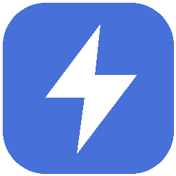
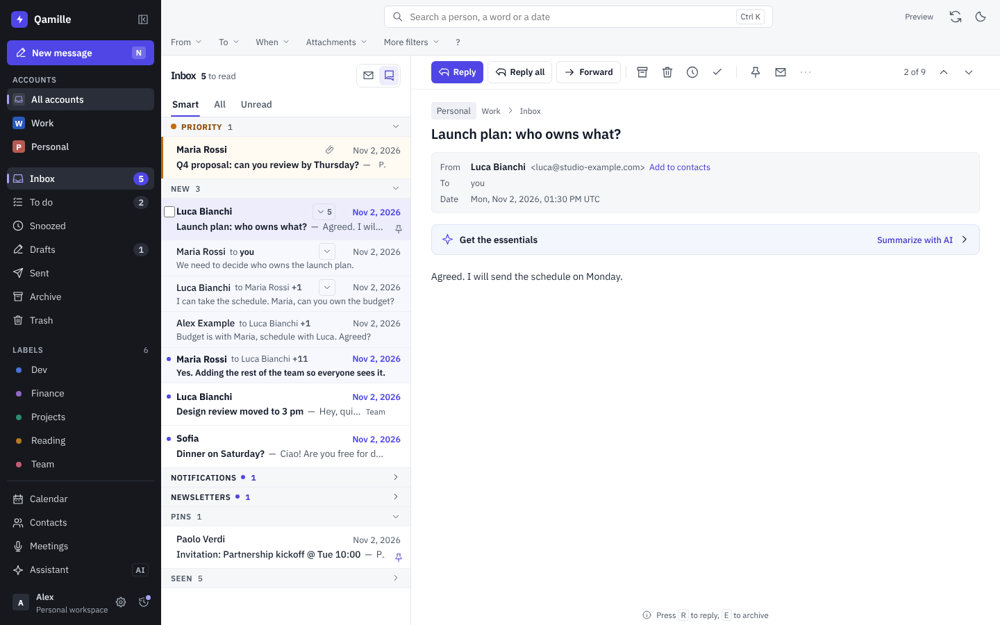

<p align="center">
  
</p>

<h1 align="center">Qamille</h1>

<h3 align="center">Your inbox. Your meetings. Your context.</h3>

<p align="center">
  Email, meetings and AI. Finally in one place.<br />
  Organize your inbox, record conversations and find what matters.
</p>

<p align="center">
  
  <a href="https://www.rust-lang.org/"></a>
  <a href="https://tauri.app/"></a>
  <a href="https://react.dev/"></a>
  
</p>

<p align="center">
  <a href="#features">Features</a> ·
  <a href="#quick-start">Quick start</a> ·
  <a href="#guides">Guides</a>
</p>

<p align="center">
  
  <br />
  <sub>Actual desktop app in demo mode. All accounts and messages are sample data.</sub>
</p>

<a id="features"></a>
## Less switching. More doing.

| | What you get |
| :--- | :--- |
| 📬 **One inbox. Every account.** | Gmail accounts together. Threads, snooze, tasks, autosaved drafts, attachment previews, scheduled sends, mail export and offline storage controls. |
| 🎙️ **Record it. Keep the context.** | Capture microphone and system audio during **Meet, Zoom or Teams**. Import audio, transcribe with **Whisper on your Qamille server**, even on your own PC with Docker, or with your own provider key, generate summaries and source-linked action items, and export your notes. No meeting bot. |
| 🔔 **Never miss the next call.** | Floating reminders for local events and your primary Google calendar. **Join** or **Join and record**, with one click. |
| 🔎 **Find meaning, not just words.** | **EmbeddingGemma 2 + BM25** search email and supported attachments, including static images. Background indexing with pause, resume and visible coverage. |
| ✨ **Ask your workspace.** | Questions about email and saved meetings, with sources you can reopen. Use **your Qamille server** (no key to paste: Qamille tells you before you agree whether it forwards requests to an outside service), or bring **local Ollama, Anthropic or an OpenAI-compatible endpoint** with your own key. |
| 🗓️ **Keep people and plans together.** | **Google Calendar**, unified local and Google contacts, vCard import and duplicate management. |
| 🔌 **Bring your own agents.** | Connect **Codex, Claude and other MCP clients**. You choose which accounts they can access and what they can do. |

<sub>Transcription runs after recording. Meeting reminders require Qamille to stay open, even minimized.</sub>

## Your data stays with you

Qamille is **portable**: mail, recordings and the index live in `data/` beside the app. Semantic search and Whisper transcription run on a Qamille server, even on your own PC with Docker ([guide](docs/server-sul-pc.md)); without a server Qamille is a complete mail client with keyword search. Remote AI providers receive the content needed for your requests.

Keep that folder private: it also contains the key to your encrypted credentials. Only record meetings with the required permission.

<a id="quick-start"></a>
## Quick start

On Windows, install **Node.js 22.12+**, **Rust stable** with edition 2024 support, **Visual Studio C++ Build Tools** and **WebView2**. From the repository root:

```powershell
.\build-release.bat --no-install
.\Start-Qamille.cmd
```

The app is built to `release/Qamille.exe` (without `--no-install` it is also installed into `D:\Software\Qamille`). Add an account in **Settings → Accounts**. See the [OAuth guide](docs/oauth-google.md) if Google sign-in needs configuration.

Just looking around? Run `Preview-Qamille.cmd` after building to open a separate demo workspace with sample data.

<details>
<summary><strong>Local development</strong></summary>

```powershell
cd desktop
npm ci
npm run desktop
```

Stack: **Rust · Tauri 2 · React 19 · TypeScript · Tailwind CSS · Motion (unlumen UI) · ONNX Runtime · SQLite FTS5**.

See the [desktop guide](desktop/README.md) for manual builds and tests. Standalone builds must include `--features custom-protocol`.

The optional server with user accounts and password sign-in lives in `server/` (standalone crate `qamille-server`); see the [server guide](server/README.md).

</details>

## Guides

[Meetings](docs/meetings-implementazione.md) · [Search and indexing](docs/indicizzazione-completa.md) · [AI agents and MCP](docs/assistenti-installazione.md) · [Portable storage](docs/portable.md)

**In active development for Windows and Gmail.** Some real-device and provider checks remain open; see the [verification reports](docs/verification/) and limitations in the guides. Scheduled sends and background work need a running Qamille process and an awake computer. Detailed guides are currently mostly in Italian.

## Contributing

Ideas, bug reports and pull requests are welcome. Describe the problem, include relevant tests and keep personal data and credentials out of your contributions.

## License

Qamille's license is **not yet specified**. Available source does not automatically grant reuse rights. Third-party components retain their [own licenses](app/src/infrastructure/meeting_processing/THIRD_PARTY.md).

---

<p align="center">
  <strong>Less time piecing things together. More time moving forward.</strong>
</p>
