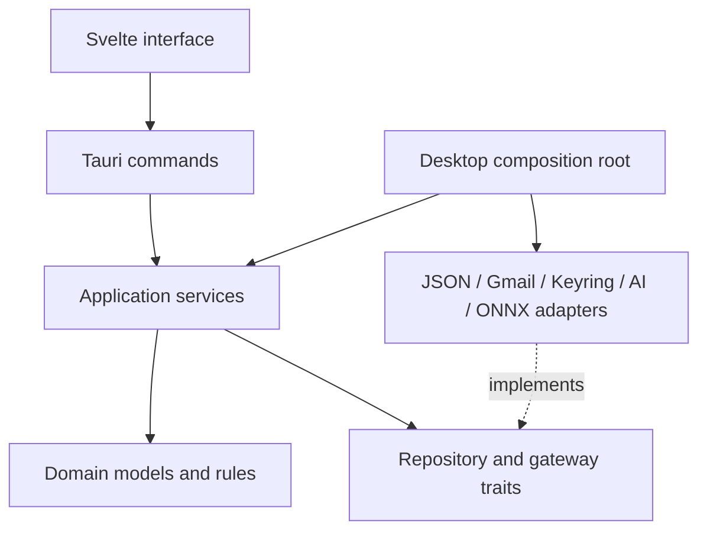

# Rust architecture

## Where changes belong

| Layer | Location | Responsibility |
|---|---|---|
| Domain | `src/domain` | Serializable entities, message rules, signatures and HTML/text transformations. No filesystem, network or UI dependencies. |
| Application | `src/application` | Mail, draft, workspace, account, assistant and scheduler use cases. Coordinates ports and validates state transitions. |
| Infrastructure | `src/infrastructure` | JSON repository, Gmail protocols, credentials, OAuth, AI providers, attachments, ONNX and audio implementation. |
| Adapters | `src/adapters`, `desktop/src-tauri/src/commands` | Native UI, MCP and Tauri request/response translation. |
| Composition | `desktop/src-tauri/src/runtime.rs` | Chooses concrete implementations and injects them into services. |

`StoreRepository`, `MailGateway`, `SecretStore`, `AttachmentGateway`, `Clock`,
`SearchGateway`, `AssistantGateway` and `GoogleIdentity` are object-safe ports.
Services accept their dependencies; they do not construct platform implementations.
Traits model replaceable I/O. The services themselves do not need redundant traits
that just duplicate all of their methods.

## Storage and concurrency

`StoreRepository::transaction` is one atomic read-modify-write of the aggregate.
An operation is called once, and only a successful operation commits. The JSON
adapter holds an OS file lock, rereads the latest data, writes a temporary file,
flushes it and atomically replaces the data file. The memory adapter has the same
rollback contract. Invalid JSON is reported without replacing it with sample data.

Account storage rules live in `domain/storage.rs`; `AccountStorageService` previews
policy changes and requests confirmation when a lower limit would clear local
copies. The repository enforces each changed account's quota at commit, including
its measured semantic-index records. Drafts, pending actions and explicitly
protected offline content cannot be evicted. Physical disk admission is handled
by the infrastructure adapter, separately from these logical account budgets.

Post-commit index and attachment maintenance runs under a fresh store lock. A
cleanup failure leaves a retry marker instead of reporting a saved transaction
as rolled back. An unreadable optional search index is preserved separately and
marked for rebuilding; an unreadable mail store is never silently reset.

The initial adapter intentionally preserves the old `store.json` format and data
location. It still reads the aggregate as JSON; replacing it with a database is a
separate change, not hidden inside the UI migration. Pagination limits the UI
transfer, not the repository's internal memory usage.

Long-running application-service operations execute outside repository transactions.
Tauri uses blocking workers for synchronous providers, leaving the UI event loop
available. The legacy MCP dispatcher is an exception during migration: mutating
tools execute inside a repository transaction, including any provider work they
perform. This is documented technical debt, not the pattern for new services.

Draft saves use an optimistic version (`updated`) and reject stale changes. Draft
sends are serialized per service instance and only remove the version that was
sent. A newer external edit is preserved. Remote mail actions commit locally only
after the provider accepts them. A provider success followed by a disk failure is
reported; there is no false claim of a distributed transaction across IMAP/SMTP
and disk.

Secrets are held behind `SecretStore`, hydrate requests only when needed and are
excluded from serialized account/settings types. Frontend requests never receive
passwords, refresh tokens, AI keys or Google client secrets.

## Compatibility

`lib.rs` temporarily re-exports old module names so the native adapter can use the
same implementations. `native-ui` enables egui; Tauri explicitly disables the
default features of the shared crate. HTML parsing stays in the domain; egui text
rendering is in `adapters/native/rendering.rs`.

`infrastructure/legacy_store.rs` retains old `Store` I/O entry points for the
native UI and legacy integrations. New code uses repository ports instead.
Native/MCP orchestration can now migrate one use case at a time without changing
the Tauri UI or replacing provider code.

## Test surface

`tests/services.rs` uses the same service interfaces as the Tauri adapter with a
memory repository and fake providers. It covers failed actions, stale drafts,
failed/successful sends, deduplication, scheduler retries, secret exclusion,
pagination, rollback, corrupted data and concurrent commits.
