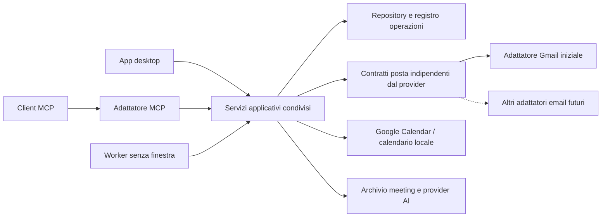

# Server MCP completo per Qamille — specifica proposta

**Stato:** ambito v0.2 approvato per l'implementazione il 2 novembre 2026. Esiti e limiti nel [rapporto di implementazione](mcp-implementazione.md). **Requisito confermato:** Gmail e Google Calendar iniziali, architettura estendibile ad altri provider email.

**Obiettivo:** permettere a un assistente collegato via MCP di usare posta, bozze, invio, calendari, eventi, meeting e attività di Qamille, con gli stessi dati e le stesse regole dell'app desktop.

## 1. Ambito e decisioni proposte

| Area | Risultato richiesto nella versione completa |
| --- | --- |
| Posta e ricerca | Ricerca locale, sul server e semantica; lettura di messaggi, conversazioni e allegati; organizzazione, esportazione e sincronizzazione. |
| Bozze e invio | Creazione, modifica, risposta, risposta a tutti, inoltro, allegati, firme, Ccn, invio immediato e programmato, annullamento prima dell'invio e stato verificabile. |
| Calendari ed eventi | Calendari locali e Google Calendar: elenco, ricerca, creazione, modifica, eliminazione, ricorrenze, invitati, risposte agli inviti, disponibilità e collegamenti video. |
| Meeting e attività | Ricerca e lettura di appunti/trascrizioni, modifica delle note, importazione, trascrizione, sintesi, esportazione e conversione delle azioni in attività, bozze o eventi. |
| Gestione e affidabilità | Account e capacità disponibili, autorizzazioni, operazioni in corso, conflitti, errori recuperabili, registro delle operazioni e funzionamento senza finestra desktop. |

**Servizi iniziali confermati:** Gmail e Google Calendar. **Requisito strutturale fin dalla prima versione:** aggiungere in futuro altri provider email mediante adattatori, mantenendo gli stessi strumenti MCP e flussi applicativi. I connettori aggiuntivi verranno realizzati successivamente; la separazione dai dettagli di Gmail appartiene alla prima consegna.

**Assunzioni esplicite:** Windows e archivio Qamille esistente; client MCP locale via `stdio`. La rubrica iniziale è quella ricavata dai corrispondenti della posta. Candidati successivi sono un connettore Microsoft Outlook/365 e un connettore IMAP/SMTP generico; ordine e supporto effettivo saranno definiti separatamente. CalDAV, Google People e accesso remoto HTTP restano estensioni successive.

La versione completa include le bozze Gmail sincronizzate e Google Calendar: fermarsi al calendario locale o alle bozze locali costituisce una consegna intermedia. L'implementazione non deve confondere «strumento esposto» con «funzione collegata al servizio reale».

«Tutto» copre i flussi indicati nella tabella, non l'esecuzione di comandi arbitrari sul computer. Creazione/cancellazione di account, modifica delle credenziali, condivisione dei calendari e installazione di modelli restano nelle impostazioni dell'app. La registrazione audio continua a richiedere l'avvio esplicito nell'interfaccia; MCP può elaborare registrazioni già salvate.

## 2. Punto di partenza verificato nel codice

| Evidenza | Comportamento attuale | Conseguenza per il progetto |
| --- | --- | --- |
| [Adattatore MCP](../app/src/adapters/mcp.rs), [avvio desktop](../desktop/src-tauri/src/main.rs) | `--mcp` esiste; espone 21 strumenti tramite JSON-RPC su stdio. Risposte prevalentemente testuali; versione richiesta dal client riportata senza verifica effettiva. | Estendere il server esistente e rendere esplicito il contratto, senza creare un secondo prodotto separato. |
| [Servizi posta](../app/src/application/mail.rs), [MCP](../app/src/adapters/mcp.rs) | Il desktop possiede servizi di ricerca remota e lettura online; il dispatcher MCP usa ancora percorsi legacy su `Store`. | Collegare gli strumenti ai servizi condivisi, incluse disponibilità dei corpi e copertura della ricerca. |
| [Bozze](../app/src/application/drafts.rs), [scheduler](../app/src/application/scheduler.rs) | MCP programma `send_at`; l'esecuzione dipende dal runtime desktop. Il modello di bozza e `OutgoingMessage` non hanno Ccn. | Introdurre outbox persistente, esecuzione senza UI, Ccn e sincronizzazione delle bozze cloud. |
| [Calendario](../app/src/application/workspace.rs), [modelli](../app/src/domain/model.rs), [OAuth](../app/src/infrastructure/oauth.rs) | Eventi locali; niente identità del calendario/provider, ricorrenze o gateway Google Calendar. OAuth richiede attualmente posta e indirizzo email. | Il calendario remoto è una nuova integrazione, con modelli e autorizzazione dedicati. |
| [Architettura](../app/ARCHITECTURE.md), [stato archivio](posta-online-implementazione.md), [meeting](meetings-implementazione.md) | Repository JSON con lock condiviso; migrazione SQLite ancora distinta; archivio meeting dedicato. Alcune chiamate MCP fanno lavoro esterno dentro una transazione. | Riutilizzare i repository; spostare rete e AI fuori dai lock; non includere implicitamente una migrazione completa dell'archivio. |

Queste sono osservazioni del sorgente, non nuovi collaudi dell'app o degli account reali. Le specifiche di [ricerca](ricerca-email-specifica.md), [posta online](posta-online-specifica.md) e [meeting](meetings-specifica.md) restano i riferimenti per grammatica, conservazione e registrazioni.

## 3. Architettura e avvio



1. **Un solo insieme di servizi.** MCP traduce argomenti e risultati; le regole risiedono in `application`. Riutilizzare `MailService`, `DraftService`, `MeetingService`, `UndoService` e le porte esistenti. Aggiungere `CalendarService`, gestione outbox e registro operazioni dove mancanti.
2. **Composizione indipendente dalla UI.** Estrarre la costruzione delle dipendenze dal runtime Tauri. La modalità MCP non inizializza finestre, microfono o cattura audio. Il recupero dei job verifica il proprietario prima di considerare interrotta un'operazione avviata da un altro processo.
3. **Avvio compatibile.** Conservare `qamille-desktop.exe --mcp`; aggiungere `--mcp-profile <nome>` per i permessi. Il client locale avvia questo processo usando il percorso assoluto dell'eseguibile. Le impostazioni producono la configurazione con il percorso realmente installato.
4. **Worker condiviso.** Modalità proposta `--worker`, avviabile senza finestra. Un proprietario per archivio, identificato tramite lock/lease del sistema operativo, esegue outbox, sincronizzazioni e scadenze. Desktop e processi MCP possono accodare lavoro senza duplicare gli invii. Nessun lock dell'archivio resta acquisito durante rete o AI.
5. **Durata esplicita.** Invio immediato disponibile con UI chiusa finché un runtime è attivo. Per invii dopo la chiusura di tutti i client serve il worker persistente, attivabile nelle impostazioni all'accesso Windows. Computer spento o sospeso: nessuna promessa di puntualità. Al risveglio, ritardo fino a 15 minuti eseguibile automaticamente; oltre, stato `needs_review`, soglia configurabile.

Le scritture condividono revisioni e notifiche di invalidazione: modifiche MCP visibili nella UI entro 2 secondi in condizioni locali normali, senza riavvio. I processi legacy incompatibili con il nuovo formato devono rifiutare le scritture invece di sovrascrivere campi nuovi.

### 3.1 Supporto futuro ad altri provider email

| Vincolo dalla prima versione | Comportamento richiesto |
| --- | --- |
| Contratti comuni e adattatori | I servizi dipendono da contratti per lettura/sync, ricerca remota, azioni, bozze remote e invio. Riutilizzare ed estendere le porte esistenti senza imporre un'unica interfaccia enorme. La composizione sceglie l'adattatore per account; nessuna chiamata Gmail diretta dal dispatcher MCP. |
| Identità indipendente dal servizio | Ogni account ha ID interno stabile e `provider_id`; i riferimenti remoti sono opachi e circoscritti al provider/account. Non ricavare il provider dal dominio email. Conservare gli ID degli account esistenti durante l'evoluzione del modello. |
| Capacità effettive | Esporre per account ricerca remota, thread nativi, etichette/cartelle, bozze cloud, allegati, invio e relativi limiti. Distinguere capacità del connettore, concessioni OAuth e permessi del profilo MCP; una funzione è utilizzabile solo se tutti i requisiti sono soddisfatti. |
| Autenticazione e calendario separati | Ogni adattatore gestisce i propri endpoint, credenziali e rinnovi tramite il gestore segreti comune. Un account email non implica un calendario Google: selezione di calendario e provider calendario sono indipendenti dal mittente email. |
| Contratto MCP stabile | `search_emails`, `create_draft`, `send_draft` e gli altri strumenti restano uguali tra provider. Le differenze vengono descritte nei risultati e nelle capacità, senza richiedere strumenti specifici come `gmail_send` o riscritture dell'assistente. |

Etichette Gmail e cartelle di altri servizi non sono equivalenti: l'adattatore conserva la semantica remota e dichiara quali operazioni supporta. Thread assenti nel provider possono essere ricostruiti localmente con provenienza esplicita. Se manca la sincronizzazione delle bozze, le bozze locali restano disponibili con `sync_status=local_only`; una richiesta esplicita di bozza cloud restituisce `unsupported_capability`. La ricerca remota non disponibile non viene simulata come completa. Il formato di origine delle bozze diventa `local/remote` più `provider_id`, evitando un enum pubblico limitato a Gmail.

L'outbox, le revisioni e il registro operazioni sono comuni a tutti i provider. L'adattatore traduce accettazione dell'invio, copia negli Inviati, limiti e incertezza remota senza indebolire la protezione dalle ripetizioni. Un guasto di un account non impedisce le operazioni indipendenti sugli altri; le ricerche su più account restituiscono copertura ed errori per account.

**Criterio strutturale:** aggiungere un secondo adattatore simulato, con capacità diverse da Gmail, deve richiedere solo implementazione e registrazione dell'adattatore, senza modificare gli schemi MCP o inserire condizioni sul nome del provider nei servizi comuni. Questo verifica l'estendibilità, non certifica il supporto reale a Outlook o ad altri servizi.

## 4. Contratto MCP e dati comuni

### 4.1 Versioni e trasporto

Il target proposto comprende MCP `2026-07-28` e compatibilità con `2025-11-25` / `2025-06-18`. Le modalità richiedono gestione distinta: la revisione moderna usa metadati per richiesta e `server/discover`; le precedenti usano `initialize`. Il server dichiara solo revisioni effettivamente implementate e testate; una versione sconosciuta non viene semplicemente ripetuta nella risposta. [Riferimento ufficiale sulle versioni](https://modelcontextprotocol.io/specification/2026-07-28/basic/versioning).

Per la prima distribuzione il trasporto è stdio, con messaggi UTF-8 delimitati da newline e log separati su stderr. Un endpoint HTTP pubblico non fa parte di questa consegna. [Trasporto stdio](https://modelcontextprotocol.io/specification/2025-11-25/basic/transports).

Ogni strumento ha schema di input e output, limiti, descrizione degli effetti e annotazioni coerenti. Le risposte includono `structuredContent` e una rappresentazione testuale utilizzabile dai client; l'involucro segue la revisione selezionata. `tools/list` è paginato e ordinato stabilmente. Errori di protocollo e fallimenti operativi sono distinti; questi ultimi usano `isError`. [Contratto degli strumenti](https://modelcontextprotocol.io/specification/2026-07-28/server/tools).

### 4.2 Regole comuni

| Campo / regola | Contratto proposto |
| --- | --- |
| Identità e selezione | ID opachi serializzati come stringhe; mapping persistente con gli ID locali/provider. Ogni riferimento include account o calendario. Scritture con destinazione esplicita, oppure derivata univocamente da una risorsa esistente; mai scegliere il primo account in silenzio. |
| Paginazione | `limit` predefinito 20, massimo 100; `cursor` opaco legato a query, ambito e ordinamento. `next_cursor`, `has_more`; conteggi qualificati come esatti/stimati/sconosciuti. Cursore scaduto: errore esplicito, nessun risultato saltato silenziosamente. |
| Date | Nuovi argomenti: RFC3339 con offset e fuso IANA quando necessario. Eventi giornalieri: date civili e fine esclusiva. Orari locali ambigui o inesistenti rifiutati con spiegazione. I vecchi argomenti data vengono convertiti usando il fuso dell'app. |
| Modifiche e ripetizioni | Modifiche con `expected_revision`; campo omesso = invariato, `null` = azzera solo se ammesso. `idempotency_key` obbligatoria per creazioni, invii e altre operazioni con effetti duplicabili nel contratto nuovo. Stessa chiave con contenuto diverso = conflitto. |
| Risultati | `data`, `meta`, eventuale `operation_id`, `warnings`; `meta` include origine, aggiornamento, copertura, paginazione e troncamento quando pertinenti. Errori con `code`, `message`, `retryable`, dettagli e prossima azione utile. |

Le letture lunghe sono paginabili anche all'interno di corpi, allegati e trascrizioni. Limite proposto per risposta: 256 KiB; input JSON: 1 MiB. Il troncamento è segnalato con cursore, non presentato come contenuto completo. File grandi si trasferiscono per handle/risorse, non dentro una singola chiamata JSON.

Le risorse restituite dal server usano URI `qamille://` associati a handle autorizzati, MIME, dimensione e durata di disponibilità. Se vengono esposte risorse MCP, implementare e dichiarare `resources/list`, `resources/templates/list` e `resources/read` secondo la revisione supportata; la lettura applica gli stessi permessi dello strumento originario. I file grandi restano scaricabili tramite file gestiti, senza rendere obbligatorio caricare tutto il binario nel contesto del modello. I prompt predefiniti sono opzionali: nessuna funzione essenziale deve dipenderne.

## 5. Catalogo funzionale

Nomi proposti in `snake_case`; gli strumenti già presenti mantengono il nome. I campi comuni della sezione 4 si applicano alle righe seguenti. Le operazioni non disponibili per un provider restituiscono `unsupported_capability` con il motivo, senza successi simulati.

### 5.1 Account, stato e organizzazione

| Strumenti | Input e risultato essenziale |
| --- | --- |
| `get_server_info`, `get_account_status`, `list_accounts` | Versioni, fuso, account autorizzati, capacità effettive, stato autenticazione/sync, modalità offline, worker e limiti. Mai segreti. |
| `sync_accounts` | Account e ambito; restituisce job, avanzamento, risultato per account e nuova copertura. Non confondere sync dell'Inbox recente con archivio completo. |
| `list_folders`, `list_labels`, `manage_label` | Account, nome/ID e operazione create/rename/delete. Conteggi qualificati; cancellare un'etichetta non cancella i messaggi. |
| `search_contacts` | Query, account, cursore; indirizzi e nomi osservati, provenienza e data. Distinguere corrispondenti osservati da contatti salvati. |
| `list_signatures`, `save_signature`, `delete_signature` | Firme e associazioni agli account; revisione per modifica. Le bozze applicano le stesse preferenze del compositore. |

### 5.2 Ricerca, lettura e azioni sulla posta

| Strumenti | Input e risultato essenziale |
| --- | --- |
| `list_emails`, `search_emails`, `semantic_search` | Query, account/cartelle, ambito `local/server/auto`, cursore, ordine. Risultati con origine, motivo della corrispondenza, data e copertura. |
| `read_email`, `read_thread` | ID, formato `text/html/headers`, campi richiesti, cursore. Recupero online del contenuto mancante; thread sempre circoscritto all'account. La lettura non marca automaticamente come letto. |
| `list_attachments`, `read_attachment`, `download_attachment` | Messaggio e allegato; metadati, testo estratto paginato oppure file gestito. Tipo non estraibile distinto da contenuto vuoto. |
| `email_action`, `undo_operation` | Azione enumerata, ID, parametri e ambito `message/thread`; massimo 100 elementi. Esito per elemento e stato remoto. Annullamento solo quando ancora possibile. |
| `export_emails`, `classify_email`, `generate_reply` | Esportazione EML/MBOX; suggerimento categoria/etichette; risposta salvata come bozza. AI esplicita e tracciata; nessun invio implicito. |

`search_emails` usa la grammatica già condivisa: mittente/destinatari, oggetto, testo, allegati, intervalli di date, account, cartelle, etichette, stato, AND/OR, esclusioni e parentesi. `auto` cerca localmente e integra dal provider quando necessario e autorizzato; restituisce la copertura effettiva e gli account non raggiunti. `server` non retrocede silenziosamente a sola cache. La ricerca semantica indica copertura dell'indice e recupera le fonti prima di fornire estratti.

`email_action` conserva le 27 azioni già dichiarate dal progetto; espone parametri tipizzati per snooze, promemoria, scadenza, spostamento, etichette e categorie. Aggiunge assegnazione esplicita dello stato a operazioni oggi basate su toggle, per renderle ripetibili. Eliminazione definitiva separata dall'azione cestino e soggetta alla politica distruttiva della sezione 8.

### 5.3 Bozze, allegati e invii

| Strumenti | Input e risultato essenziale |
| --- | --- |
| `list_drafts`, `read_draft` | Account, cursore o ID; contenuto completo, revisione, provenienza `local/remote`, `provider_id`, stato cloud, allegati e programmazione. |
| `create_draft`, `update_draft`, `delete_draft` | Account, To/Cc/Bcc come liste, oggetto, testo o HTML, firma, revisione. Modalità `new/reply/reply_all/forward` e messaggio sorgente; eliminazione sincronizzata quando applicabile. |
| `attach_to_draft`, `remove_draft_attachment` | ID bozza e handle file/allegato già autorizzato. Copia gestita stabile; verifica tipo, dimensione e revisione. Nessun percorso arbitrario letto dal modello. |
| `send_draft`, `send_email` | Bozza e revisione, oppure contenuto completo con account; chiave di idempotenza. `send_email` usa internamente la stessa pipeline bozza/outbox. Ritorno dell'operazione, non un generico «inviato». |
| `schedule_draft`, `cancel_scheduled_send`, `list_outbox` | Data/fuso, revisione e chiave; annullamento o elenco con stato. Modifica di una bozza già accodata richiede annullamento o nuova revisione esplicita. |

Il formato supporta testo e HTML con le regole del compositore. Risposta a tutti esclude gli indirizzi propri e rimuove duplicati; risposte e inoltri preservano intestazioni e collegamento al thread. Ccn entra nella busta di invio ma non compare nelle intestazioni consegnate agli altri destinatari. Allegati inline e normali vengono distinti; limite iniziale totale 25 MiB, ulteriormente ridotto se il provider lo richiede.

**Bozze remote, prima implementazione Gmail:** aggiungere una porta comune per le bozze remote e il relativo adattatore Gmail; memorizzare identità remota e revisione/hash di sincronizzazione. Una bozza creata/modificata in Gmail deve essere riconoscibile dall'app e viceversa. Le copie locali non sincronizzate restano recuperabili. Due modifiche concorrenti producono conflitto e conservazione delle versioni; non prevale automaticamente l'ultima arrivata. L'invio cloud e SMTP devono condividere il registro per non spedire due volte la stessa bozza. Altri adattatori potranno implementare la stessa porta quando il servizio supporta le bozze remote.

### 5.4 Calendari, disponibilità ed eventi

| Strumenti | Input e risultato essenziale |
| --- | --- |
| `list_calendars`, `sync_calendar` | Account/calendario; provider, ID, fuso, ruolo, capacità, stato sincronizzazione e job. Calendario locale identificato esplicitamente. |
| `list_events`, `search_events`, `read_event` | Calendari, intervallo, testo, cursore; evento completo, organizzatore, partecipanti/RSVP, ricorrenza, istanza, link, promemoria e revisione. |
| `create_event`, `update_event`, `delete_event` | Calendario, titolo, descrizione, date, invitati, ricorrenza, promemoria, conferenza e politica notifiche. Per serie: ambito obbligatorio `instance/series/following`. |
| `respond_to_event`, `find_free_slots` | RSVP `accepted/tentative/declined`; oppure calendari/partecipanti, intervallo, durata, ore di lavoro e margini. Disponibilità non accessibile = sconosciuta. |
| `import_events`, `export_events` | Handle ICS oppure ID/intervallo. Anteprima importazione con conteggi/conflitti e applicazione idempotente; esportazione restituisce un file gestito. |

Per gli eventi remoti, creazione e modifica usano Google Calendar, non solo l'array locale. Distinguere evento personale, evento con partecipanti e invio degli aggiornamenti. Il parametro `send_updates` è esplicito; con invitati il comportamento proposto è `all`, segnalato nell'anteprima. Non promettere assenza assoluta di email scegliendo `none`. Le conferenze Google Meet vengono richieste al provider e possono restare `pending`; il risultato non inventa un URL. [Creazione eventi e notifiche](https://developers.google.com/workspace/calendar/api/v3/reference/events/insert).

`find_free_slots` combina calendari selezionati e dati free/busy accessibili; restituisce anche fonti mancanti e data della verifica. Non garantisce la disponibilità di una persona senza accesso al suo calendario. [Free/busy Google](https://developers.google.com/workspace/calendar/api/v3/reference/freebusy/query).

Sincronizzazione per calendario con paginazione, token incrementale, eventi cancellati e riconciliazione delle istanze ricorrenti. Token scaduto: risincronizzare la proiezione remota conservando modifiche pendenti e dati locali. [Elenco eventi e token](https://developers.google.com/workspace/calendar/api/v3/reference/events/list), [errori API](https://developers.google.com/workspace/calendar/api/guides/errors).

Il modello aggiunge almeno `calendar_id`, `provider_event_id`, `etag/revision`, organizzatore, partecipanti con RSVP, fuso, all-day, ricorrenza/eccezioni, promemoria, stato e stato sync. Aggiornamenti condizionati evitano sovrascritture concorrenti. Modificare «questa e le successive» può richiedere più operazioni remote: registrare avanzamento ed eventuale risultato parziale.

### 5.5 Meeting, attività e operazioni

| Strumenti | Input e risultato essenziale |
| --- | --- |
| `list_meetings`, `search_meetings`, `read_meeting`, `read_meeting_segments` | Filtri, ID, versione e cursore; mantenere riferimenti temporali e alle fonti, rispettando le esclusioni dalla ricerca automatica. |
| `update_meeting_notes`, `import_meeting`, `transcribe_meeting`, `summarize_meeting`, `export_meeting` | Revisioni, handle audio, modello già configurato e formato; job persistente per elaborazioni lunghe. AI remota solo se abilitata. |
| `list_tasks`, `create_task_from_source`, `update_task`, `complete_task` | Origine email/meeting, titolo, scadenza e stato; collegamento permanente alla fonte. Le azioni meeting restano suggerimenti finché non convertite esplicitamente. |
| `get_operation`, `list_operations`, `cancel_operation`, `retry_operation` | ID/stato; avanzamento, risultato, errore e possibilità effettiva di annullamento/riprova. Invii incerti esclusi dai tentativi automatici. |
| `get_preferences`, `update_preferences`, `list_activity` | Preferenze consentite e revisioni; fuso, ore lavorative, calendario/account predefinito. Registro per data/account/tipo; mai modifica delle autorizzazioni o lettura di credenziali. |

Le attività restano locali a Qamille: nessuna sincronizzazione con Google Tasks implicita. Estendere il modello per attività da meeting senza crearle come false email. La conversione in bozza o evento passa attraverso gli strumenti ordinari e restituisce i relativi ID.

## 6. Invio affidabile, concorrenza e operazioni lunghe

### 6.1 Stati dell'invio

```text
draft -> queued | scheduled -> sending -> sent
                              |          |
                              |          -> sent_not_saved
                              -> failed | unknown
queued | scheduled -> cancelled
scheduled in forte ritardo -> needs_review
```

`sent` significa accettato dal provider/SMTP, non consegnato o letto dal destinatario. `unknown` significa che l'esito remoto non è determinabile; `sent_not_saved` indica accettazione remota con salvataggio locale incompleto. Entrambi richiedono riconciliazione prima di un eventuale nuovo invio.

1. Validare account, destinatari, contenuto, allegati, autorizzazione e revisione; salvare uno snapshot immutabile della busta e del messaggio nel registro prima di contattare il provider.
2. Associare chiave di idempotenza, hash degli argomenti e ID messaggio/operazione. Persistenza e claim tra processi impediscono che desktop e MCP acquisiscano lo stesso invio.
3. Eseguire rete fuori dalla transazione. Salvare esito remoto e risultato locale separatamente; aggiornare UI e cartella Inviati preservando modifiche successive alla bozza.
4. Ripetere automaticamente solo guasti precedenti a effetti remoti o operazioni dimostrate idempotenti, con attese progressive e rispetto dei limiti del provider. Non ripetere SMTP dopo timeout ambiguo o crash durante l'invio.
5. Con la stessa chiave restituire l'operazione originale. Conservare chiavi/risultati almeno 30 giorni dopo lo stato terminale; mai eliminare automaticamente record incerti. Dopo scadenza del periodo non promettere deduplicazione illimitata.

Non viene promessa consegna SMTP «esattamente una volta». Il requisito è evitare ripetizioni cieche e rendere visibile l'incertezza. Una funzione di riconciliazione consulta il provider quando possibile; la sola assenza di un messaggio tra gli Inviati non dimostra che non sia partito.

### 6.2 Job e batch

Operazioni superiori a 10 secondi restituiscono un `operation_id` durevole e avanzamento tramite `get_operation`. Il registro applicativo funziona anche con client che non supportano estensioni MCP per i task. La chiusura del client non annulla un invio già accodato; l'annullamento richiede un'azione esplicita e viene rifiutato quando l'effetto remoto è iniziato.

Batch: validazione dell'intera richiesta, poi risultati individuali `succeeded/failed/pending/unknown`. Nessuna falsa atomicità tra account o servizi. Modifiche concorrenti a bozze, note ed eventi restituiscono `revision_conflict` con revisione corrente; l'utente non perde il proprio contenuto.

## 7. Ricerca, dati e modalità offline

Ogni risposta di ricerca distingue risultati locali, remoti e semantici, ambito controllato e parti non controllate. Valori proposti di copertura: `complete_for_scope`, `partial`, `unknown`; disponibilità: `online/offline`. «Zero risultati» con copertura parziale non equivale a «nessuna email esistente».

I corpi online e gli allegati rispettano le politiche di conservazione già approvate; l'accesso MCP non crea un archivio permanente parallelo. Identità del provider e deduplicazione impediscono che lo stesso messaggio compaia più volte solo perché appartiene a più etichette. Risultati remoti oltre la cache restano leggibili tramite riferimenti stabili.

Offline: letture disponibili dalla cache con stato di aggiornamento; bozze locali salvabili; scritture remote solo come operazioni pendenti se la politica lo consente. Invii richiesti offline diventano esplicitamente `queued_offline`, non `sent`; questo stato rientra nella famiglia `queued`. Eventi e bozze cloud non risultano sincronizzati prima della conferma del provider.

L'archivio JSON corrente è riutilizzabile per la prima fase. Registro operazioni, revisioni e mapping remoti richiedono scritture atomiche, backup prima del cambio di formato e versione minima dei writer. L'eventuale database dedicato al registro non comporta automaticamente la migrazione di tutta la posta prevista nella specifica distinta.

## 8. Autorizzazioni e impostazioni

| Profilo / capacità | Effetto |
| --- | --- |
| Lettura | Ricerca, lettura, disponibilità, esportazione dei dati autorizzati e stato. Account e calendari ammessi configurabili. |
| Organizzazione | Lettura più bozze, etichette, archivio/cestino, note, attività ed eventi esclusivamente locali. Nessun invio o invito. |
| Invio e calendario remoto | Organizzazione più invii, programmazione, modifiche a eventi remoti e RSVP; capacità separabili per account/calendario. |
| Capacità aggiuntive | `ai.execute`, importazione file, eliminazione definitiva e gestione del worker sono concessioni esplicite, non conseguenze automatiche del livello Invio. |
| Revoca | Verifica a ogni chiamata e prima dell'effetto remoto. Operazioni non ancora partite si fermano se viene revocato il permesso necessario. |

Le impostazioni mostrano profilo, ambiti, worker attivo e ultima operazione. Una concessione persistente valida evita conferme ripetute per invii e modifiche autorizzati. Le cancellazioni definitive richiedono autorizzazione concreta dal client fidato o dall'interfaccia; un argomento `confirmed: true` non concede nuovi diritti. I profili legacy `ReadOnly/Triage/Send` vengono migrati senza attribuire implicitamente l'accesso a nuovi calendari o capacità.

Per stdio, l'identità attendibile è il profilo locale scelto all'avvio e protetto dall'account del sistema operativo; `clientInfo.name` non è una prova d'identità. Il modello non può autoassegnarsi autorizzazioni. Le annotazioni MCP aiutano il client ma i controlli avvengono nel server.

OAuth Google Calendar richiede un consenso aggiuntivo agli scope minimi necessari per elenco calendari, eventi e disponibilità. Le credenziali restano nel gestore segreti già usato dall'app. Collegare l'account non significa inviare automaticamente email o inviti di prova.

File: import/export attraverso handle di file scelti o directory esplicitamente ammesse, con percorsi canonici verificati e protezione da traversal/symlink. Messaggi, allegati e trascrizioni sono contenuti esterni, non istruzioni capaci di cambiare permessi. Il registro conserva metadati dell'operazione, riferimenti e stato; non corpi completi, password o token nei log diagnostici.

## 9. Compatibilità e superfici da modificare

| Superficie | Modifica prevista |
| --- | --- |
| `app/src/adapters/mcp.rs` | Separare trasporto/versioni, registro strumenti, validazione, presentazione e adattatori ai servizi; eliminare le mutazioni dirette legacy. |
| `app/src/application/*` | Composizione senza UI, calendario, outbox, job, revisioni, autorizzazioni e parità dei casi d'uso desktop/MCP. |
| `app/src/domain/*`, `app/src/infrastructure/*` | Modello account/provider e capacità, estensioni a bozze/eventi/attività, adattatori Gmail e Google Calendar dietro porte comuni, registro durevole, identità e scope OAuth per provider. |
| `desktop/src-tauri/src/*`, impostazioni e calendario Svelte | Worker condiviso, aggiornamenti visibili, configurazione MCP, profili e stato sincronizzazione; rappresentare gli eventi remoti con le stesse identità. |
| `app/tests/*`, `desktop/tests/*`, documentazione | Prove di protocollo, servizi, crash/concorrenza, flussi UI e istruzioni di installazione/configurazione. |

I 21 nomi esistenti restano riconoscibili. Le letture conservano gli argomenti precedenti; vengono aggiunti output strutturati e avvisi di deprecazione. `send_draft(date=...)` continua a significare accodamento/programmazione, ora eseguibile dal worker. `read_email` conserva la vista legacy con conversazione; un nuovo parametro consente di richiedere il solo messaggio e `read_thread` rende esplicita la lettura della conversazione.

**Cambiamenti intenzionalmente incompatibili sulle scritture:** niente fallback a un account inesistente; azioni non valide rifiutate; revisioni e chiavi obbligatorie nel nuovo contratto per le operazioni che le richiedono. Se un vecchio client non le fornisce, restituire un errore di aggiornamento con argomenti richiesti prima di modificare dati. Non dichiarare piena compatibilità delle scritture senza questi adeguamenti. Il formato dei dati conserva default leggibili e una procedura di ripristino documentata.

## 10. Criteri di accettazione

### Protocollo e accesso

1. Client moderno e client legacy elencano e chiamano strumenti secondo la propria revisione; richieste/versioni non supportate restituiscono errori corretti. Stdout contiene esclusivamente messaggi MCP.
2. Tutti gli strumenti validano gli input e producono output conformi allo schema, inclusi risultati vuoti, errori, batch parziali e paginazione oltre 100 elementi.
3. Un profilo Lettura non modifica contenuti utente o stato remoto né invia tramite strumenti diretti, alias, job o retry; il recupero della cache per una lettura resta consentito. La revoca blocca un invio non ancora iniziato.
4. ID di un account non consentono accesso a un altro; percorsi fuori ambito vengono rifiutati; risposte e log non contengono segreti.
5. Due processi MCP e desktop possono operare sullo stesso archivio senza perdere modifiche; un client legacy incompatibile non può sovrascrivere il formato aggiornato.

### Posta e invio

1. Un messaggio presente solo sul server si trova e si legge; risultati locali incompleti, provider non raggiungibile e indice semantico parziale sono distinguibili. Il centunesimo risultato è raggiungibile senza duplicati o salti.
2. Bozza con To/Cc/Bcc, firma, HTML e allegati mantiene contenuto e identità dopo riavvio; la bozza Gmail è visibile anche nel provider e i conflitti conservano entrambe le versioni.
3. Invio con UI chiusa riesce tramite runtime attivo; due richieste concorrenti con la stessa chiave producono una sola operazione e una sola chiamata di invio nel provider simulato.
4. Crash prima/durante/dopo l'accettazione remota produce uno stato recuperabile; un esito ambiguo non viene rispedito automaticamente. Errore di salvataggio dopo invio non viene mostrato come semplice invio fallito.
5. Programmazione, annullamento, modifica concorrente, worker spento e ripresa dopo sospensione rispettano gli stati e la politica di ritardo; nessun annullamento finge di ritirare una mail già spedita.

### Calendario e meeting

1. Creazione/modifica/cancellazione compare su Google Calendar e nella UI; evento locale resta identificato come locale. Revoca OAuth e calendario senza permesso di scrittura producono errori leggibili.
2. Eventi giornalieri, cambio ora legale, ricorrenze ed eccezioni mantengono la stessa data/ora in provider, desktop e MCP; ambito di modifica della serie sempre esplicito.
3. Inviti, RSVP, notifiche e conferenza in attesa hanno stati verificabili; free/busy parziale non viene presentato come disponibilità certa.
4. Trascrizioni e note rispettano versioni ed esclusioni; note modificate contemporaneamente non vengono perse. Nessuna chiamata di lettura avvia la registrazione audio.
5. Un'azione di meeting produce un'attività, una bozza o un evento con riferimento alla fonte, senza duplicazione quando si ripete la stessa chiave.

### Verifica e prestazioni

**Accettazione dell'estendibilità:** eseguire la stessa suite di contratto su Gmail simulato e su un secondo adattatore simulato privo di etichette, thread nativi e bozze cloud. Verificare bozze locali, errori di capacità, routing per account, identità remote uguali su account diversi, ricerca su più account con errore parziale e separazione tra account email e calendario. Una nuova integrazione reale richiederà poi prove dedicate al proprio servizio.

Usare dati sintetici e `QAMILLE_DATA` isolata per suite Rust, test MCP come processo e prove desktop. Integrare test con provider simulati per timeout, rate limit, autorizzazione scaduta, conflitti e crash. Il collaudo Gmail/Google Calendar reale resta distinto, con account di prova e destinatari esplicitamente autorizzati; test simulati non lo sostituiscono.

Budget iniziali da misurare sul PC di riferimento: avvio MCP entro 3 secondi; letture locali semplici p95 entro 1 secondo su 10.000 metadati; riconoscimento/accodamento di job entro 2 secondi senza attendere il completamento remoto. Se il repository JSON impedisce il budget, riportare la misura e pianificare l'ottimizzazione: non dichiarare il requisito verificato sulla sola anteprima browser.

## 11. Sequenza di realizzazione proposta

Le stime sono intervalli di lavoro per uno sviluppatore sul repository attuale, comprensivi di verifiche mirate; non sono una promessa di consegna in questa chat. Prerequisiti esterni, login e attese di configurazione provider sono esclusi.

| Fase | Consegna verificabile | Stima iniziale |
| --- | --- | --- |
| 1 — Fondamenta | Contratto/versioni MCP, runtime senza UI, autorizzazioni, porte indipendenti dal provider, capacità e prova con secondo adattatore simulato, strumenti sui servizi e configurazione locale. | 3–5 giorni |
| 2 — Posta completa | Ricerca server, allegati, bozze/Ccn/risposte, azioni, rubriche osservate, firme ed export con parità desktop. | 3–5 giorni |
| 3 — Invio e bozze cloud | Outbox, worker, idempotenza, crash/retry, programmazione e sincronizzazione bozze Gmail. | 4–7 giorni |
| 4 — Calendario reale | OAuth, Google Calendar, sync, eventi/ricorrenze, inviti, disponibilità, ICS e UI coerente. | 5–8 giorni |
| 5 — Meeting e collaudo | Note/job/attività, prove tra processi e account di prova, prestazioni, pacchetto e documentazione. | 3–5 giorni |

**Totale indicativo:** 18–30 giornate di sviluppo per l'ambito iniziale Google, inclusa la predisposizione ad altri provider; le prime due fasi sono utilizzabili come consegna intermedia. La realizzazione dei connettori aggiuntivi richiederà stime separate. Il lavoro di questa richiesta iniziale è la specifica: nessun server nuovo, invio reale, evento reale o installazione automatica è stato eseguito.
