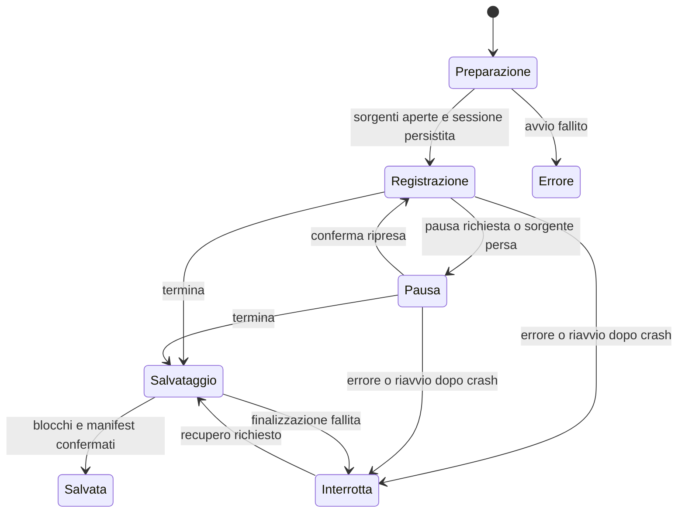

# Meeting: specifica funzionale e tecnica

**Versione:** proposta 1.0 · **Data:** 2 novembre 2026 · **Prodotto:** Qamille desktop.

**Obiettivo:** registrare entrambe le parti di una riunione, ritrovare ciò che è stato detto e ottenere appunti, decisioni e attività collegati alle fonti. La registrazione resta utilizzabile anche se la trascrizione o il modello AI falliscono.

Questa specifica resta il riferimento dei requisiti. L'implementazione del 2 novembre 2026 e le differenze ancora aperte sono nel [rapporto di implementazione](meetings-implementazione.md); non tutti i criteri di rilascio sono già verificati. La [valutazione iniziale](valutazione-meetily-qamille.md) descrive lo stato precedente all'implementazione.

## 1. Ambito e scelte iniziali

| Voce | Scelta proposta |
| --- | --- |
| Piattaforma iniziale | Windows, nuova UI Tauri 2 / Svelte 5, motore Rust condiviso. |
| Acquisizione | Microfono e audio dell'uscita selezionata; modalità solo microfono disponibile. Avvio esplicito dell'utente. |
| Lingua e AI | Italiano predefinito; trascrizione locale multilingue. Provider remoto selezionabile esplicitamente, senza passaggio automatico dal locale al cloud. |
| Persistenza | File audio e documenti versionati nella cartella dati locale; riuso del repository attuale per indice e compatibilità. Nessuna migrazione generale a SQLite in questa iniziativa. |
| Traguardi | Primo utilizzo completo dopo P3: registra/importa → trascrivi → appunti/sintesi → esporta. V1 completa dopo P4: ricerca, calendario locale, accesso MCP e stabilizzazione. |

Restano successive alla V1: separazione automatica dei singoli interlocutori, sincronizzazione calendario cloud, bot che entrano nelle chiamate, condivisione multiutente, ricerca semantica estesa a tutti i meeting. Le azioni estratte sono inizialmente elementi del verbale; conversione in task esterni o invio email richiedono un'iniziativa successiva.

### Stato iniziale osservato prima dell'implementazione

Il recorder attuale usa il microfono predefinito e un WAV; la trascrizione invia l'intero file a un endpoint compatibile OpenAI. La nuova UI mostra i meeting e salva appunti, mentre i controlli di registrazione sono nella UI nativa precedente. `Meeting` ha una trascrizione testuale unica. L'assistente aggiunge al contesto i riassunti, non una ricerca di passaggi delle trascrizioni. Fonti locali: [recorder](../app/src/infrastructure/recorder.rs), [AI](../app/src/infrastructure/ai.rs), [UI meeting](../desktop/src/components/Meetings.svelte), [modello](../app/src/domain/model.rs), [assistente](../app/src/application/assistant.rs).

## 2. Esperienza principale

1. **Avvia:** aprire Meeting, scegliere «Registra» e verificare microfono/audio computer tramite due indicatori separati. Titolo facoltativo; se vuoto viene proposto «Riunione del …».
2. **Durante:** vedere stato, durata, salvataggio e appunti. I comandi principali sono Pausa/Riprendi e Termina. «Segna questo momento» aggiunge un appunto con posizione audio.
3. **Termina:** il salvataggio audio viene confermato prima dell'esito AI. La scheda resta navigabile mentre trascrizione e sintesi lavorano.
4. **Rivedi:** aprire Sintesi, Trascrizione o Appunti. Un clic su un passaggio o una citazione posiziona il player sull'audio corrispondente.
5. **Ritrova:** cercare parole, decisioni o attività, riaprire il meeting e il punto pertinente; esportare il risultato scelto.

La pagina mantiene la struttura esistente elenco/dettaglio. Un indicatore persistente segnala la registrazione anche passando a Posta o Calendario. Le nuove righe di trascrizione non spostano il focus; lo scorrimento automatico si interrompe quando l'utente consulta passaggi precedenti e riparte solo con «Torna al presente».

Il percorso «Importa audio» apre lo stesso dettaglio dopo validazione e copia locale del file. Nessun modello installato impedisce di registrare o prendere appunti: la scheda offre «Configura trascrizione» e conserva l'audio.

## 3. Requisiti verificabili

### A — Acquisizione e recupero

| ID | Comportamento richiesto | Criterio di accettazione |
| --- | --- | --- |
| AUD-01 | Selezionare microfono e uscita; salvare entrambi con controlli di livello distinti. La cattura di sistema comprende l'uscita scelta, non promette isolamento della sola app meeting. | Con cuffie, una voce locale e un segnale riprodotto dal PC risultano entrambi nell'audio; solo microfono esclude il canale sistema. Nessun cambio silenzioso della sorgente. |
| AUD-02 | Avvio, pausa, ripresa e stop sono operazioni confermate dal motore; una sola registrazione attiva per cartella dati. | Doppio clic o retry non creano sessioni duplicate; pausa esclude l'intervallo dal tempo audio, la ripresa mantiene allineati i canali. |
| AUD-03 | Salvare blocchi audio durante la sessione, indipendentemente dall'AI; persistere la sessione prima di mostrare «Registrazione in corso». | Su arresto del solo processo, con disco funzionante, recuperare tutti i blocchi confermati. Checkpoint di massimo 1 s per sorgente, conferma su disco e recupero verificabile anche senza gli indici principali. La coda ancora nei buffer può andare persa: misurarla sui dispositivi reali, senza dedurre un limite di perdita dal solo intervallo dei checkpoint. |
| AUD-04 | Perdita dispositivo, coda piena, errore di scrittura o spazio insufficiente producono un avviso persistente e uno stato recuperabile. | Alla perdita di una sorgente mettere in pausa e offrire ripresa con l'altra sorgente o riconfigurazione. Errori di scrittura/overflow interrompono la sessione preservando i blocchi confermati. La timeline marca eventuali campioni mancanti prima dell'arresto; nessuna falsa conferma di registrazione completa. |
| AUD-05 | Stop e uscita ordinata preservano quanto acquisito; il riavvio identifica sessioni interrotte. | Durante la registrazione, chiudere offre «Termina e salva» o «Continua a registrare» mantenendo aperta l'app. Dopo crash compare «Registrazione interrotta — recupera»; il recupero non riattiva automaticamente il microfono. |

### T — Trascrizione, importazione e riproduzione

| ID | Comportamento richiesto | Criterio di accettazione |
| --- | --- | --- |
| TRN-01 | Provider STT separato dal provider dei riassunti; lingua italiana selezionabile. Download del modello con dimensione, avanzamento, annullamento e verifica d'integrità. | Un modello mancante o un download fallito lasciano la registrazione utilizzabile; nessun invio di audio/testo per elaborazione remota in modalità locale. Il download richiesto dall'utente usa la rete; il file incompleto non viene caricato. |
| TRN-02 | Trascrizione progressiva se sostenibile, altrimenti differita, a partire da audio già salvato. | Il riconoscimento lento non rallenta l'acquisizione. L'interfaccia distingue «Registrazione», «Trascrizione in corso» e «Da elaborare»; ogni blocco ha un esito persistito, anche se fallisce. La fixture di silenzio non produce frasi pubblicate. |
| TRN-03 | Segmenti con ID stabile, versione e intervallo audio; player, ricerca nella trascrizione e correzione del testo. | Tempi ordinati e compresi nella durata audio; clic sul segmento posiziona il player entro 500 ms dall'inizio memorizzato. Questo verifica il player, non l'accuratezza linguistica dell'allineamento. Le correzioni conservano testo originale e revisione. |
| TRN-04 | Importare inizialmente WAV, MP3, M4A/AAC e FLAC nei profili di codec confermati dal prototipo. Ritrascrivere con modello/lingua diversi. | Corruzione o codec non supportato causano errore prima del lavoro AI. Importazione interrotta e ritrascrizione fallita non sostituiscono una trascrizione valida. I formati effettivamente testati sono elencati nella UI. |
| TRN-05 | Annullamento, retry ed esecuzioni ripetute conservano le versioni e impediscono risultati vecchi sopra dati nuovi. | Il risultato arriva con ID lavoro e revisione di input; un lavoro annullato o superato non diventa versione attiva. Nessun punteggio di affidabilità viene inventato quando il motore non lo fornisce. |

### N — Appunti e verbali

| ID | Comportamento richiesto | Criterio di accettazione |
| --- | --- | --- |
| NTE-01 | Appunti liberi e appunti con posizione temporale, salvataggio automatico e stato visibile. | Dopo conferma «Salvato», riaprire mantiene testo e riferimenti. Debounce iniziale 800 ms, flush al cambio meeting/chiusura; conflitto di revisione conserva la bozza locale per confronto. |
| SUM-01 | Produrre direttamente nella lingua scelta: sintesi, punti chiave, decisioni e attività. Le attività hanno responsabile, scadenza e stato opzionali. | Nel corpus di accettazione non compaiono responsabili o scadenze assenti dalle fonti. I campi sconosciuti sono vuoti; non vengono completati per supposizione. |
| SUM-02 | Collegare decisioni e attività alle fonti: segmenti di trascrizione o appunti. | Ogni decisione/attività pubblicata ha almeno un riferimento valido alla versione di input. Un appunto senza timestamp resta citabile come appunto, senza generare un tempo audio artificiale. |
| SUM-03 | Gestire meeting lunghi tramite budget di contesto e sintesi a blocchi per qualsiasi provider. | Nessun troncamento silenzioso. Se un blocco fallisce, il verbale completo non viene dichiarato pronto; un eventuale risultato parziale è marcato incompleto con intervalli mancanti. |
| SUM-04 | Rigenerare senza perdere modifiche, template o versioni precedenti. Errori AI espliciti. | Il vecchio verbale resta disponibile fino a risultato nuovo valido; modifiche manuali e output AI restano distinguibili. Un estratto deterministico di frasi non viene presentato come riassunto AI riuscito. |

### M — Archivio e integrazioni

| ID | Comportamento richiesto | Criterio di accettazione |
| --- | --- | --- |
| MGT-01 | Elenco paginato, titolo modificabile, data, durata e stato separato di audio/trascrizione/verbale. | Cercare titolo e filtrare data/stato senza caricare tutte le trascrizioni in UI. Riapertura conserva selezione, tab e posizione. |
| MGT-02 | Collegare un meeting a un evento del calendario locale oppure crearne uno indipendente. | Collegamento reversibile; eliminare/modificare l'evento non cancella il meeting né l'audio. Il titolo può essere inizializzato dall'evento senza sovrascrivere modifiche successive. |
| MGT-03 | Cercare testualmente in trascrizioni, appunti e verbali; usare passaggi pertinenti nelle risposte dell'assistente. | Ogni risultato distingue meeting da email, mostra estratto e fonte/versione; i passaggi temporizzati aprono il player. In assenza di evidenza l'assistente lo dichiara. |
| MGT-04 | Esportare Markdown, testo e JSON, scegliendo sintesi/appunti/trascrizione. | Esportare la versione selezionata, con timestamp quando disponibili e indicazione di contenuto incompleto; il file può essere riletto senza l'app. Nessuna condivisione automatica. |
| MGT-05 | Mantenere `list_meetings` e `read_meeting` MCP compatibili; aggiungere accesso paginato ai passaggi. | I vecchi argomenti continuano a funzionare; i nuovi riferimenti leggono la stessa versione della UI. Un meeting escluso dalla ricerca viene escluso anche dal contesto automatico dell'assistente. |

### Q — Controllo, compatibilità e qualità

| ID | Comportamento richiesto | Criterio di accettazione |
| --- | --- | --- |
| QUA-01 | UI semplice e accessibile, stati testuali, funzionamento da tastiera e aggiornamenti non invasivi. | Focus stabile durante registrazione/trascrizione, lettura dei livelli non affidata solo ai colori, messaggi di errore con una possibilità concreta di recupero. |
| QUA-02 | Audio e dati restano locali salvo provider remoto scelto per la funzione specifica; credenziali nel sistema esistente. | La scheda mostra dove avvengono trascrizione e sintesi. I log ordinari non includono audio, trascrizioni, appunti o chiavi. Le trascrizioni sono trattate come dati, non come istruzioni per il modello. |
| QUA-03 | Supportare i meeting esistenti e impedire scritture concorrenti incompatibili fra UI legacy e desktop. | Fixture legacy leggibile senza perdita di campi; nessun timestamp inventato per trascrizioni storiche. La UI legacy non modifica meeting nel nuovo formato; accesso concorrente incompatibile alla stessa cartella viene rifiutato. |
| QUA-04 | Gestire spazio, esportazione e cancellazione come operazioni esplicite. | Prima di rimuovere un meeting mostrare cosa verrà eliminato e richiedere conferma; interrompere i suoi lavori prima della cancellazione. Rimuovere anche indice/contesto. I file audio importati originali fuori dall'archivio non vengono eliminati. |
| QUA-05 | Tenuta di sessioni lunghe e provenienza upstream verificabili. | Prova Windows di 2 ore, buffer audio e code entro limiti indipendenti dalla durata, nessuna perdita silenziosa e verifica dei contatori. Ogni porzione upstream adottata riporta commit, attribuzione e test di adattamento. |

## 4. Stati e contratti di comportamento

Registrazione, trascrizione e sintesi sono processi distinti. «Audio salvato» può coesistere con «Trascrizione fallita». L'interfaccia non usa un solo stato «Completato» per nascondere questa differenza.

Un lavoro STT/sintesi/importazione passa da `queued` a `running`, quindi a `completed`, `failed` o `cancelled`; un arresto del processo produce `interrupted` al riavvio. L'utente può riprenderlo con un nuovo tentativo dello stesso lavoro. `partial` è uno stato del risultato, non una prova di completamento del lavoro. Un risultato nuovo diventa attivo solo dopo validazione e controllo della revisione di input.

Gli eventi UI trasportano `meeting_id`, `job_id` ove applicabile e revisione/numero di sequenza crescente. Sono notifiche: dopo riconnessione la UI rilegge lo snapshot persistito. Livelli e timer possono perdere aggiornamenti intermedi; stato, blocchi confermati ed errori devono essere ricostruibili dal repository.

### Tempo, tracce e parlanti

Il tempo audio è monotono ed esclude le pause deliberate. Data/ora reale, pause e cambi sorgente sono conservati separatamente. Un buco di acquisizione avvenuto mentre la sessione era attiva occupa un intervallo dichiarato nella timeline, non viene nascosto comprimendo il tempo. Le tracce condividono lo stesso riferimento temporale.

Microfono e sistema sono **sorgenti**, non identità dei parlanti. V1 non assegna automaticamente nomi ai partecipanti. I segmenti del mix hanno sorgente `mixed` e nessun `speaker_id` inventato. Correggere testo non modifica i tempi; una ritrascrizione crea nuovi segmenti/versione e non riaggancia automaticamente vecchie citazioni a frasi diverse.

## 5. Architettura proposta

Rispettare [l'architettura del progetto](../app/ARCHITECTURE.md): dominio senza I/O, servizi che coordinano porte, adattatori Tauri sottili. La tabella indica componenti da creare o estendere, non file già presenti.

| Livello | Componenti previsti | Responsabilità |
| --- | --- | --- |
| Dominio | `app/src/domain/meeting.rs`, estensione compatibile di `Meeting` | Sessione, segmenti/versioni, appunti, decisioni, attività, stati e transizioni. |
| Applicazione | `application/meetings.rs`, porte in `application/ports.rs` | `MeetingService`; `MeetingRepository`, `AudioCapture`, `SpeechToText` e `MeetingSummarizer` come confini I/O. Riutilizzare `Clock` e `SecretStore`. |
| Infrastruttura | `infrastructure/meeting_repository.rs`, `infrastructure/meeting_audio/`, `infrastructure/meeting_stt/`, adattatore sintesi | Persistenza, CPAL, ricampionamento, decoder, modelli e provider. Nessuna chiamata Tauri dal dominio o dai servizi. |
| Desktop | `runtime.rs`, `commands/meetings.rs`, gestione uscita in `main.rs` | Iniezione dei servizi, ciclo di vita, comandi e inoltro degli eventi; errori con codici stabili. |
| UI e integrazioni | `Meetings.svelte`, componenti meeting, `types.ts`, `api.ts`, preview, assistente/MCP | Presentazione degli stati, player, editor, risultati e citazioni. Preview interamente sintetica. |

Il motore audio vive su un thread dedicato che possiede gli stream CPAL; `DesktopState` conserva un controller thread-safe, non assume che gli stream possano essere spostati tra thread. Le callback audio copiano su buffer limitati: niente rete, inferenza o scrittura file bloccante. Il writer ha priorità sulla trascrizione, che consuma blocchi persistiti. Un overflow è un errore misurato e visibile, non una perdita ignorata.

### Comandi Tauri proposti

| Gruppo | Contratti |
| --- | --- |
| Preparazione e controllo | `meeting_audio_devices`, `start_meeting_recording(request_id, title?, event_id?, sources)`, `pause_meeting_recording`, `resume_meeting_recording`, `stop_meeting_recording` |
| Lettura | `list_meetings` compatibile; nuovo `query_meetings(filters, cursor)`, `read_meeting_detail(id)`, `list_meeting_segments(id, version, cursor)` |
| Lavori | `import_meeting_audio`, `transcribe_meeting`, `summarize_meeting`, `cancel_meeting_job`, `retry_meeting_job`, `recover_meeting_recording` |
| Modifiche | `save_meeting_notes` compatibile, nuovo `save_meeting_note(..., expected_revision)`, `update_meeting`, `correct_meeting_segment`, `update_meeting_action` |
| Archivio | `search_meetings`, `export_meeting`, `delete_meeting`; accesso audio tramite risorsa registrata dal backend e associata al meeting |

I nomi sono un contratto proposto da fissare in P1. Ogni comando di modifica controlla stato e revisione. `request_id` rende idempotenti avvio/import e avvio lavori; stop ripetuto restituisce lo stesso esito. Errori previsti: `device_unavailable`, `recording_busy`, `storage_full`, `model_missing`, `unsupported_audio`, `revision_conflict`, `job_interrupted`. L'adattatore frontend attuale trasforma gli errori in testo: estenderlo per conservare il codice senza mostrare dettagli tecnici all'utente.

## 6. Dati e persistenza

| Entità | Campi essenziali e regole |
| --- | --- |
| Meeting/sessione | ID compatibile con il `u64` attuale, titolo, evento opzionale, data, durata audio, stato acquisizione, revisione, sorgenti e preferenze di elaborazione. |
| Blocco audio | Sessione, sorgente, sequenza, inizio/fine in campioni o ms, formato, percorso relativo, integrità, stato confermato; intervalli mancanti separati. |
| Trascrizione | Versione, modello/lingua e versione del modello, revisione audio, segmenti con ID e tempi, testo originale/corretto, eventuale confidenza realmente fornita. |
| Appunto/verbale | Appunti con revisione e posizione opzionale; verbali con versione, fonti, template, lingua, modello, decisioni e attività. Citazioni come `(tipo, versione, id)`. |
| Lavoro | ID, tipo, input e revisione, configurazione senza segreti, stato/tentativo, avanzamento reale, ultimo blocco confermato, errore e riferimenti al risultato. |

Percorso proposto: `<data>/meetings/<id>/` con `session.json`, blocchi audio, revisioni di trascrizione/verbale e record dei lavori. Non memorizzare audio in `store.json` né riscrivere l'aggregato a ogni campione/segmento. JSON dei dettagli con `schema_version`, scrittura temporanea, flush e sostituzione atomica; blocchi confermati immutabili. I percorsi forniti alla UI non autorizzano letture o cancellazioni arbitrarie fuori dal meeting.

**Autorità dei dati:** per un meeting V2 il repository meeting è autorevole. `Store.meetings` mantiene una proiezione compatibile di titolo, durata, testo, appunti e sintesi per i chiamanti storici. La proiezione ha una revisione associata nel repository meeting e può essere ricostruita; non è una seconda fonte modificabile indipendentemente. Il servizio instrada anche i comandi legacy di modifica appunti al repository corretto. Per meeting senza archivio V2, `Store.meetings` resta autorevole finché una conversione esplicita termina.

**Creazione e crash fra file:** riservare l'ID e un record preparatorio tramite transazione store; scrivere la sessione prima di avviare l'audio. Confermare blocco file prima di citarlo nel manifest. All'avvio riconciliare record preparatori, cartelle, manifest e proiezioni; verificare gli orfani completi e recuperare dai WAV temporanei soltanto i frame interi fisicamente presenti, conservando gli originali in quarantena. Mantenere copie precedenti degli indici e verificare checksum e identità indipendenti per i blocchi nativi. Nessuna pretesa di transazione atomica fra tutti i file.

**Compatibilità:** migrazione lazy con backup e controllo revisione; il vecchio WAV resta referenziabile e la trascrizione storica è un testo privo di tempi finché non viene rielaborata. Letture dei meeting V2 passano dal servizio anche per MCP; il passaggio degli strumenti MCP ai nuovi dati deve precedere la disponibilità pubblica del formato. La UI nativa precedente conserva la lettura compatibile ma blocca modifiche/registrazioni sui meeting V2; applicare il vincolo di esclusione fra processi UI alla cartella dati, lasciando l'accesso MCP controllato dai repository.

**Concorrenza:** lock per sessione, controllo di revisione per note e versioni attive; nessun lock sullo store durante inferenza, rete o registrazione. Conservare le trascrizioni/verbali precedenti finché l'utente non li elimina. La cancellazione crea prima una tombstone e annulla i lavori, poi rimuove dati e indici; dopo crash riprende la pulizia senza ricreare la proiezione.

## 7. Politiche audio, modelli e sintesi

### Audio e limiti iniziali

Configurazione implementata: due tracce mono WAV PCM16 alla frequenza nativa del dispositivo, checkpoint al massimo ogni **1 secondo** di audio e code di acquisizione limitate a 1 secondo per sorgente. Il manifest completo usa un buffer di scrittura e conferme periodiche; ogni blocco conserva una ricevuta indipendente. Con entrambe le tracce a 48 kHz, il consumo teorico è circa **0,69 GB/ora**, esclusi modelli, originali importati e file derivati. Il mix per STT viene ricampionato a 16 kHz; l'originale importato si conserva separatamente dalla rappresentazione di lavoro.

Il player può leggere una timeline di blocchi e produrre il mix al bisogno; non richiedere un WAV monolitico o FFmpeg per dichiarare l'audio salvato. Il rapporto temporale fra campioni, ricampionamento, pause e cambi dispositivo deve essere esplicito. Attenuazione/limitatore evitano clipping del mix; cancellazione eco e diarizzazione restano capacità future. Testare comunque sia cuffie sia altoparlanti per misurare il comportamento reale.

Soglie iniziali proposte: controllare spazio prima di start/import e durante la sessione; avvisare sotto 1 GiB libero, interrompere in modo recuperabile sotto 256 MiB o al primo errore di scrittura. I valori sono configurazione tecnica, non un limite fisso alla durata del meeting. Le operazioni import e download controllano anche la dimensione prevista. Errori durante il flush restano visibili anche se parte dell'audio è già salvata.

### Trascrizione

Whisper multilingue è il candidato iniziale; Parakeet V3 è un candidato alternativo da confrontare sull'italiano e sull'hardware disponibile. Non cambiare automaticamente il modello dopo un aggiornamento. Prima di integrare, verificare le dipendenze sulla versione CPAL/ORT già usata dal progetto; isolare un motore solo se l'esperimento dimostra che il porting non è sostenibile.

VAD con durata massima del segmento, non solo attesa del silenzio: proposta 15 s, sovrapposizione 500 ms, deduplicazione nelle zone di overlap. I blocchi di salvataggio da 5 s e le unità STT da 15 s sono oggetti distinti. I lavori conservano la copertura dell'audio e gli intervalli falliti. Un engine lento accumula riferimenti a blocchi su disco, non copie audio illimitate in RAM.

Anche l'adattatore STT remoto lavora su unità limitate rispettando formato, dimensione e durata accettati dal provider configurato, con ricomposizione dei tempi. Non riutilizzare l'attuale caricamento dell'intero WAV per registrazioni lunghe. UI e query caricano pagine limitate di segmenti; la proiezione testuale legacy può crescere con il contenuto, ma non deve essere aggiornata per ogni callback audio.

La modalità progressiva è abilitata per configurazioni che nel benchmark completano 1 secondo di audio in non più di 0,8 secondi medi, con margine di coda verificato. In caso di arretrato superiore a 2 minuti, indicare «Trascrizione in ritardo» e passare a elaborazione differita preservando il lavoro. Lo stop non aspetta il completamento della trascrizione. Alla riapertura applicare una sola volta i risultati già conclusi e verificati dai checkpoint separati, rispettando revisione e annullamento. Per i lavori ancora incompleti proporre un nuovo tentativo; nessun invio remoto riparte senza un'azione esplicita.

### Riassunti e provenienza

Il servizio usa il modello già configurato e un budget di contesto esplicito per provider/modello, riservando spazio all'output. Se il limite non è noto, usare un budget conservativo dichiarato e ridurre i blocchi su errore di contesto. Estrarre fatti con ID fonte per blocco, poi consolidare senza perdere i riferimenti. Le citazioni restano collegate alla versione originale anche dopo correzioni o ritrascrizione.

Output strutturato validato prima della pubblicazione. Un solo tentativo correttivo per JSON invalido; errori temporanei ritentati al massimo due volte con attesa e cancellazione, mai in ciclo infinito. L'app non esegue istruzioni presenti in trascrizioni/appunti e non crea automaticamente email, eventi o task. Richieste di rigenerazione non sovrascrivono appunti manuali. «La trascrizione è cambiata» segnala che un verbale si riferisce a una versione precedente.

## 8. Verifica e completamento

| Gruppo | Prove richieste |
| --- | --- |
| Acquisizione | Due sorgenti riconoscibili, cuffie/altoparlanti, pausa/ripresa, cambio o rimozione dispositivo, silenzio, overflow, disco pieno e stop ripetuto. |
| Recupero | Arresto durante scrittura blocco, aggiornamento manifest, modifica appunti e attivazione risultato; recupero idempotente, nessun lavoro superato pubblicato. |
| Italiano e sintesi | Corpus iniziale di almeno 30 minuti con riferimento umano: italiano pulito, nomi/termini tecnici e audio rumoroso/sovrapposto. Misurare WER, errori su nomi, velocità e memoria; per i verbali contare attribuzioni/scadenze non supportate e verificare tutte le citazioni. |
| Compatibilità e UI | Fixture legacy, accesso desktop/MCP, conflitti note, migrazione interrotta, preview con dati sintetici, tastiera e lettura degli stati, esportazione e cancellazione. |
| Durata e prestazioni | Sessione di 2 ore sul PC di riferimento; acquisizione continua, buffer audio/code entro budget definito in P0, senza crescita con la durata. Misurare separatamente memoria del modello e dei testi. Comandi UI sotto 200 ms al 95° percentile nel test locale, escluso il tempo di apertura hardware/inferenza. |

Prima del rilascio registrare macchina, dispositivi, modelli, versioni e risultati. Nessun dato reale dell'utente è necessario per i test automatici. L'affermazione «salvato» riguarda dati confermati; non promette sopravvivenza a guasto fisico del disco. La qualità STT è misurata sul corpus scelto, non dedotta dal nome del modello.

## 9. Riferimento upstream

Meetily resta una fonte selettiva, fissata inizialmente al commit `a2cb62e827da7ef59f65064c97233efb2313878e`. Consultare il [registro upstream](../reference/README.md) prima di ogni fase pertinente e seguire il processo lì definito per aggiornare la revisione.

Riutilizzare soprattutto i confini tra acquisizione, writer, STT e sintesi; adattare il codice ai nostri contratti e ai nostri test. Non assumere che template commerciali, diarizzazione, punteggi di confidenza o moduli alternativi siano già disponibili nel percorso Community attivo. La [ricerca tecnica](ricerca-meetily-upstream.md) conserva fonti e limiti della revisione esaminata.
