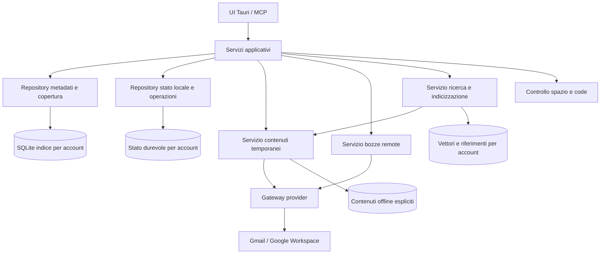

# Posta online e indice locale — specifica funzionale e tecnica

**Prodotto:** Qamille · **Versione:** proposta 1.2 · **Data:** 2 novembre 2026.

**Obiettivo:** usare Gmail come archivio dei messaggi, degli allegati e delle bozze, mantenendo sul computer un database compatto di metadati, riferimenti e indici. Evitare che la lettura e la sincronizzazione costruiscano automaticamente una seconda casella completa sul disco.

**Stato:** specifiche per lavoro futuro. La direzione e la scelta **spazio limitato o illimitato per singolo account** sono richieste dall’utente. Default iniziale proposto: **2 GB per account**, modificabile; soglie interne, modalità di recupero delle bozze e dettagli dei protocolli restano proposte di implementazione. Questo documento non dichiara la migrazione già eseguita.

**Avanzamento del 2 novembre 2026:** le impostazioni per account, la pulizia locale, il download offline esplicito e il nuovo formato dell’indice semantico sono descritti nello [stato di implementazione](posta-online-implementazione.md). La specifica resta il riferimento completo per le parti ancora da migrare.

## 1. Decisioni e perimetro

1. **Il server conserva l’originale.** Messaggi ricevuti, inviati, cartelle/etichette, allegati e bozze sincronizzate hanno un riferimento remoto. Aprire una cartella non comporta scaricare i suoi corpi o allegati.
2. **Il database locale contiene l’indice.** Identità, intestazioni selezionate, stato, riferimenti, avanzamento della sincronizzazione ed eventuali vettori; nessun testo del corpo, estratto persistente o indice lessicale del corpo in modalità standard.
3. **I contenuti si recuperano quando servono.** Lettura, anteprima, stampa, esportazione, assistente e indicizzazione hanno richieste separate e annullabili. L’indicizzazione semantica richiede comunque trasferimento temporaneo del testo.
4. **Spazio e copertura sono espliciti.** Ogni account ha un limite modificabile, inizialmente 2 GB, oppure la modalità «Illimitato». Ogni quota riguarda solo quell’account. La UI distingue posta presente sul server, metadati locali e messaggi indicizzati semanticamente.
5. **Le copie permanenti sono una scelta.** Download/esportazioni richiesti dall’utente e messaggi marcati «Disponibile offline» sono distinti dal funzionamento standard. Non vengono creati da una semplice sincronizzazione.

Il primo provider resta **Gmail / Google Workspace**, con il backend Rust e la UI Tauri/Svelte esistenti. Altri provider, sincronizzazione Google Calendar e archivio audio dei meeting non sono inclusi. Le relative cartelle locali non rientrano nella quota della posta e devono essere contabilizzate separatamente nell’eventuale riepilogo generale dell’app.

Non viene aggiunto un server gestito da Qamille. «Online» significa il provider dell’account. La scelta di un modello AI remoto resta indipendente: questa migrazione non autorizza l’invio automatico della casella a un servizio AI.

### 1.1 Eccezione proposta: proteggere ciò che si sta scrivendo

Una bozza già confermata dal provider può restare solo online. Le modifiche successive non ancora confermate esistono invece soltanto nel processo: senza una copia temporanea non si può garantire il recupero dopo un crash o una chiusura mentre manca la rete.

**Proposta da validare prima dell’implementazione delle bozze:** consentire un registro locale cifrato, limitato alle revisioni non ancora sincronizzate e agli allegati appena aggiunti non ancora caricati. Tetto iniziale **32 MiB per account**, incluso nel suo consumo locale; la chiave risiede nel vault portable della cartella dati. Non è una copia permanente della casella. Quando il server conferma la revisione, il contenuto di recupero corrispondente viene rimosso. Il limite tecnico del recupero resta valido anche con spazio account illimitato.

La cifratura avviene **prima** della scrittura, così anche WAL e temporanei contengono solo dati cifrati; il contenuto non entra nei log. La conferma della revisione N non rimuove il recupero della revisione N+1. Se la chiave non è disponibile, mostrare «Recupero locale non disponibile», conservare gli eventuali dati cifrati esistenti e applicare le protezioni di chiusura della modalità solo RAM: nessun ripiego in chiaro. Alla quota massima, impedire nuovi allegati e ulteriore crescita non protetta, consentendo salvataggio online o esportazione esplicita senza espellere revisioni uniche.

Se si sceglie invece «nessun contenuto scritto sul disco», la modalità deve dichiarare il limite: una revisione presente solo in RAM si perde dopo crash; la chiusura con modifiche non confermate richiede attendere il server, esportare volontariamente o scartare esplicitamente. Non presentare contemporaneamente questa modalità e una garanzia di recupero dopo crash.

## 2. Situazione attuale e differenze richieste

Riscontri statici nel codice al momento della redazione; non costituiscono collaudo con un account reale.

| Area attuale | Modifica richiesta |
| --- | --- |
| `StoreRepository` legge e riscrive l’aggregato JSON, contenente anche i corpi delle email. | Repository con query paginate e transazioni circoscritte; separazione tra metadati, contenuti temporanei e stato non ricostruibile. |
| `MailGateway::sync` restituisce `Email` complete; il percorso IMAP scarica `BODY.PEEK[]` e salva gli allegati. | Sincronizzazione di metadati e recupero selettivo di parti MIME. Nessun download automatico degli allegati ricevuti. |
| L’indice RAG salva vettore e testo di ogni passaggio in `rag_index.bin`. | Vettori e riferimenti/versioni soltanto; ricostruzione dei passaggi dal contenuto remoto quando servono. |
| Le bozze sono locali, con salvataggio, tab multipli, Undo e invio differito. | Bozze del provider, protezione delle revisioni non confermate e conservazione dei comportamenti delle schede. |
| IDLE, conversazioni, ricerca remota e stampa/esportazione sono percorsi presenti o in evoluzione. | Tutti devono usare gli stessi riferimenti e servizi di contenuto; nessuno deve reintrodurre una copia completa nel JSON o in una cache nascosta. |

Riferimenti del progetto: [architettura Rust](../app/ARCHITECTURE.md), [porte applicative](../app/src/application/ports.rs), [repository attuale](../app/src/infrastructure/repository.rs), [provider IMAP](../app/src/infrastructure/mail.rs), [indice RAG](../app/src/infrastructure/rag.rs).

## 3. Dove risiedono i dati

| Categoria | Persistenza locale standard | Persistenza remota / recupero |
| --- | --- | --- |
| Elenchi e intestazioni | ID account/messaggio/thread, mittenti/destinatari, oggetto, date, etichette, flag, dimensioni e nomi/MIME degli allegati. | Il provider resta la fonte per il contenuto e lo stato remoto. |
| Corpi, MIME e anteprime ricevute | Solo memoria temporanea; nessun body, snippet, HTML o estratto persistente. L�indice FTS5 contentless conserva termini e posizioni per BM25, come approvato per la ricerca ibrida; non conserva una copia della riga sorgente. | Recupero delle parti necessarie all’apertura; rilascio della memoria dopo scadenza o pressione sul budget. |
| Allegati ricevuti | Nessun file automatico. Anteprima in memoria dove possibile; eventuali file temporanei necessari richiedono un’azione esplicita e una scadenza. | Recupero del singolo allegato per anteprima, download, export o indicizzazione scelta dall’utente. |
| Ricerca semantica | Vettori, riferimenti ai passaggi, hash/versioni e stato di copertura. Modello locale opzionale separato. | Il testo viene letto per indicizzare e riletto per mostrare estratti o alimentare l’assistente. |
| Bozze e stato dell’app | Preferenze, attività locali, identificativi di operazioni, schede aperte e cursori; eventuale registro di recupero della §1.1. | Corpo e allegati della bozza vengono confermati dal provider; gli stati locali non sincronizzabili non diventano dati sacrificabili. |

Metadati e vettori restano dati personali: «solo indice» non equivale a anonimizzazione. Password, refresh token e chiavi rimangono nel vault cifrato portable sotto la cartella dati, separati dal database della posta. Le garanzie di persistenza riguardano le scritture gestite da Qamille; non promettono controllo su memoria virtuale, backup del sistema o file esportati dall’utente.

## 4. Requisiti funzionali

### A — Sincronizzazione e identità

| ID | Requisito | Criterio di accettazione |
| --- | --- | --- |
| SYN-01 | Sincronizzare solo metadati, con paginazione e checkpoint. La prima schermata parte dai messaggi recenti; lo storico viene esplorato progressivamente. | Su una casella di prova con 50.000 messaggi, l’apertura di Inbox non richiede corpi o byte di allegati. Nessuna chiamata restituisce tutte le email complete alla UI. |
| SYN-02 | Usare un’identità stabile per account, messaggio, thread e parte MIME. | Spostare la stessa email tra etichette/cartelle non crea un secondo messaggio o un secondo embedding. Due account con uguale header `Message-ID` restano distinti. |
| SYN-03 | IDLE/notifiche attivano una riconciliazione; riconnessione e sincronizzazione manuale recuperano eventi persi. | Cursore scaduto o cambio `UIDVALIDITY` ricostruiscono i riferimenti dai metadati, senza scaricare automaticamente i corpi. Un errore di rete non equivale a casella vuota. |
| SYN-04 | Distinguere eliminazione remota, spostamento, assenza dalla pagina e rimozione dell’indice locale. | Un messaggio fuori dalla finestra recente non viene considerato cancellato. Una cancellazione confermata invalida indice e riferimenti; nessuna pulizia locale invia comandi di cancellazione al server. |
| SYN-05 | Conservare attività, promemoria, Undo e revisioni locali durante l’aggiornamento dei flag remoti. | Una notifica mentre un’azione è in attesa non perde il contesto dell’azione e non sovrascrive una modifica locale non confermata. I contatori specificano il loro ambito quando la copertura non è completa. |

### B — Lettura e allegati

| ID | Requisito | Criterio di accettazione |
| --- | --- | --- |
| MSG-01 | Aprire un messaggio recupera soltanto il suo contenuto necessario. La consultazione non deve marcare letto tramite il comando di download. | Il flag letto viene aggiornato dall’azione applicativa prevista; scaricare per ricerca, indice o stampa non lo modifica. Due aperture simultanee dello stesso contenuto condividono la richiesta in corso. |
| MSG-02 | Memoria temporanea limitata, con cancellazione della richiesta e controllo della revisione. | Cambiare selezione non mostra il corpo del messaggio precedente. Le risposte tardive per un account disconnesso vengono scartate. Il contenuto rilasciato non finisce in cache persistenti della UI. |
| MSG-03 | Gli allegati restano remoti finché non vengono richiesti. | Nell’elenco si vedono nome, tipo e dimensione. Aprire una mail con un allegato da 20 MiB non scarica quei 20 MiB; l’anteprima dell’allegato sì, dopo l’azione dell’utente. |
| MSG-04 | Stampa, export e download lavorano per messaggio/parte e con memoria limitata. | Un export di molte email non costruisce `Vec<Vec<u8>>` con tutti gli originali. Il file scelto dall’utente viene scritto progressivamente; interruzione e annullamento lasciano un file parziale identificabile e nessun archivio interno completo. |
| MSG-05 | Immagini remote, HTML, allegati grandi e contenuti non disponibili hanno stati espliciti. | Nessun caricamento automatico di risorse esterne per costruire un’anteprima. Un messaggio cancellato o un download fallito mostra «Non disponibile sul server» / «Riprova», non un corpo vuoto presentato come completo. |

### C — Ricerca testuale e semantica

| ID | Requisito | Criterio di accettazione |
| --- | --- | --- |
| SRC-01 | La ricerca locale senza rete riguarda metadati e gli eventuali messaggi scelti per uso offline. La ricerca nei corpi usa il provider. | Una parola presente solo nel corpo di una mail mai aperta può essere trovata online senza archiviare il corpo su disco. Offline la UI dichiara che il contenuto remoto non è stato cercato. |
| SRC-02 | Query visuale e testuale producono una rappresentazione comune; i vincoli non supportati dal provider vengono verificati su contenuti temporanei dei candidati. | Il filtro finale non accetta risultati che violano mittente, data, frase o account. Se il server non restituisce un insieme di candidati completo o il budget ferma il lavoro, l’esito è parziale. Non basta controllare solo la prima pagina. |
| SRC-03 | Dopo l'installazione esplicita del modello, scansione completa di tutte le cartelle accessibili per ogni account, senza limiti di anzianità o numero di email. Testo, metadati, documenti leggibili e immagini native; nuovi arrivi elaborati in background. | Avanzamento e pausa/ripresa per account, checkpoint per cartella/UIDVALIDITY e copertura parziale visibile. Contenuti temporanei e memoria limitata secondo [Indicizzazione completa](indicizzazione-completa.md); quote per account sempre rispettate. |
| SRC-04 | Persistenza dei soli vettori e riferimenti al passaggio. Il testo usato per l’embedding è temporaneo. | Dopo indicizzazione e chiusura dell’app, un testo marcatore inserito soltanto nei corpi non compare nei file gestiti, inclusi WAL, temporanei, cache della WebView e log. L’indice non conserva neppure token o estratti sufficienti a ricostruire il testo. |
| SRC-05 | Estratti e citazioni vengono ricostruiti online e verificati sulla stessa versione del contenuto. | Se MIME/normalizzazione/modello non corrispondono più al riferimento, il passaggio viene invalidato e reindicizzato prima di essere citato. Senza rete possono apparire risultati per significato con metadati, ma non una citazione inventata né una risposta AI presentata come fondata sul corpo non disponibile. |

La ricerca nei testi degli allegati non è implicita: il provider può non garantire equivalenza con l’estrazione locale. Il testo viene estratto temporaneamente soltanto per file selezionati e con budget dichiarato. Un PDF scansionato o un allegato cifrato non conta come contenuto ricercato. L’FTS locale può indicizzare oggetti, persone e nomi di file; non i corpi o il testo estratto dagli allegati in modalità standard.

### D — Bozze online e composizioni multiple

| ID | Requisito | Criterio di accettazione |
| --- | --- | --- |
| DRF-01 | Ogni scheda ha ID locale stabile, riferimento della bozza remota e revisione indipendente. | Aprire la stessa bozza riattiva la scheda esistente. Scrivere in due schede non mescola destinatari, testo, allegati, formattazione o operazioni di salvataggio. |
| DRF-02 | Autosave remoto dopo 1.200 ms dall’ultima modifica, con una sola scrittura in corso per bozza e raggruppamento delle modifiche successive. | «Salvata online» appare solo dopo conferma della revisione esatta; «Salvata sul dispositivo, in attesa della rete» indica l’eventuale registro locale, mai una conferma remota. Ridurre a scheda non interrompe il salvataggio. |
| DRF-03 | Recupero e chiusura seguono la scelta esplicita della §1.1. | Tutte le schede vengono considerate, incluse quelle ridotte. Una scrittura fallita non elimina la scheda. Il registro cifrato non viene espulso per liberare spazio se contiene l’unica copia di una modifica. |
| DRF-04 | Conflitti con Gmail o un altro dispositivo conservano le versioni. | Non sovrascrivere silenziosamente una revisione remota diversa. Se il provider non offre un aggiornamento condizionale atomico, conservare copie riconoscibili e proporre quale mantenere; non dichiarare impossibili tutte le corse tra dispositivi. |
| DRF-05 | Invio, invio programmato, eliminazione della bozza e Undo usano riferimenti remoti e stati persistiti. | Undo agisce prima della consegna confermata. Dopo timeout con esito di invio ignoto, riconciliare il server e chiedere revisione se non si può stabilire l’esito; nessun reinvio automatico alla cieca. Un’altra scheda aperta resta intatta. |

Gli allegati scelti durante la composizione vengono caricati con la bozza e hanno uno stato distinto dal testo. Un file locale originale non viene eliminato dall’app. Se il registro di recupero non può contenerlo, la UI può mantenere il riferimento all’originale, ma deve dichiarare che non esiste una copia di recupero e non aggiungerlo come allegato protetto. Prima dell’upload controllare che il file esista e corrisponda alla versione selezionata: se cambia o scompare, chiedere di selezionarlo nuovamente. Un percorso persistito non dimostra che la bozza sia salvata completamente.

**Invio programmato nella prima consegna:** il pianificatore rimane locale. La UI dichiara che richiede app aperta, computer acceso, rete e account collegato; una bozza online non rende la programmazione un servizio del provider. Se la scadenza passa mentre queste condizioni mancano, mostrare «Invio scaduto, da confermare» alla ripresa, senza inviare automaticamente in ritardo. La programmazione si riferisce a una revisione confermata e al suo hash; modificare il contenuto annulla o richiede di confermare nuovamente la programmazione. Prima della consegna recuperare e verificare quella revisione: una modifica da Gmail sospende l’invio, senza spedire silenziosamente il nuovo testo. Un futuro invio pianificato dal provider richiede una capacità e una specifica dedicate.

### E — Offline, azioni e controlli dell’utente

| ID | Requisito | Criterio di accettazione |
| --- | --- | --- |
| OFF-01 | Senza rete restano utilizzabili metadati già presenti, preferenze, attività locali e contenuti esplicitamente offline. | Una mail non disponibile mostra «Connettiti per leggere il messaggio». Nessun tentativo di leggere un allegato assente viene presentato come allegato vuoto. |
| OFF-02 | «Disponibile offline» è configurabile per un account intero oppure per messaggi selezionati, con stima dello spazio e stato di completamento. | Download esplicito, annullabile e riprendibile; contenuto marcato come copia locale e protetto dalla pulizia automatica. Un account completamente offline comprende corpi e allegati; non è dichiarato completo finché esistono contenuti non scaricati. Rimuovere la disponibilità offline non cancella il messaggio online. |
| OFF-03 | Azioni remote non ancora applicate restano distinguibili dallo stato confermato. | Una coda offline conserva ID, intenzione e versione, non una copia di tutti i corpi. A riconnessione la precondizione viene ricontrollata; Undo e attività non si perdono in una ricostruzione dell’indice. |
| OFF-04 | Impostazioni «Spazio sul dispositivo» mostrano categorie, limite e copertura. | Si possono svuotare contenuti temporanei, ricostruire l’indice o rimuovere il modello separatamente. Nessuno di questi comandi cancella mail sul provider, bozze non sincronizzate o file esportati. |
| OFF-05 | Disconnessione/rimozione account interrompe download, indice e notifiche prima di rimuovere dati locali. | Risposte tardive non ripopolano l’account. La UI segnala bozze non sincronizzate e copie solo locali prima della rimozione; non perde dati unici con una pulizia generica. |

### F — Più account nella stessa app

| ID | Requisito | Criterio di accettazione |
| --- | --- | --- |
| ACC-01 | Identità, credenziali, contenuti e operazioni sono sempre associati all’account proprietario. | Due account con gli stessi ID remoti o header non condividono corpo, allegati, cache, thread o bozza. Rimuovere A non cancella dati né interrompe le operazioni di B; risposte tardive di A non ripopolano l’account rimosso. |
| ACC-02 | Cursori, sessioni, stato di autenticazione e tentativi di recupero sono indipendenti per account. | Se A perde l’autorizzazione o la connessione, B continua a sincronizzare e salvare bozze. Lo stato indica quale account richiede attenzione, senza bloccare tutta l’app. |
| ACC-03 | Inbox, ricerca testuale, ricerca semantica e assistente rispettano l’ambito visibile «Tutti gli account» o la selezione esplicita. | Ogni risultato indica l’account; ordinamento e paginazione unificati non perdono messaggi. Se A completa e B fallisce, i risultati di A restano utilizzabili e l’esito generale è parziale, con copertura per account. Nessuna fonte di B entra nel contesto AI di una ricerca limitata ad A. |
| ACC-04 | Ogni scheda di composizione mostra e mantiene il proprio account mittente. | Cambiare account nella barra laterale non cambia destinatari, salvataggio o mittente delle schede aperte. Rispondere usa l’account del messaggio di origine; invio, autosave e Undo restano associati alla stessa bozza. Un cambio esplicito verso un altro account crea prima la nuova bozza remota confermata, senza eliminare preventivamente quella precedente. |
| ACC-05 | Quota e prenotazioni appartengono al singolo account; i lavori e lo spazio fisico vengono coordinati fra gli account. | A con limite 2 GB non supera la propria quota e non espelle dati di B; B può avere un limite diverso o nessun limite applicativo. Un’indicizzazione massiva di A non monopolizza i lavoratori. Se il disco è pieno, le nuove scritture si fermano senza cancellare dati di altri account per compensare. |

## 5. Budget di spazio e memoria

Ogni account ha una sola impostazione **«Spazio locale: Limitato / Illimitato»**. In modalità limitata, il default proposto è **2 GB decimali = 2.000.000.000 byte per account**, modificabile dall’utente. In modalità illimitata non si applica un tetto applicativo al totale dell’account; restano i controlli sullo spazio fisico e sui singoli lavori. Non esiste una quota condivisa né una categoria di account con eccezione.

I limiti non prenotano fisicamente il disco all’avvio. Due account con limite 2 GB possono occupare fino a 4 GB di dati attribuibili agli account, oltre ai componenti comuni e alle esclusioni dichiarate; il riepilogo mostra il consumo effettivo totale. Le altre soglie sono **default proposti da misurare**, non dimensioni già ottenute.

| Risorsa | Limite / default | Comportamento al limite |
| --- | --- | --- |
| Dati del singolo account | **Limitato: 2 GB modificabili / Illimitato**. Include DB, WAL, indice, file temporanei, recupero bozze e copie offline dell’account. | Prenotazione prima di creare/crescere file. In modalità limitata avviso all’80% del limite; pulizia della sola mail espellibile di quell’account quando necessaria. Mai eliminare dati unici. |
| Indice ricostruibile | Spazio residuo del limite dell’account, al netto di altre categorie e riserva; senza tetto totale in modalità illimitata. | Se occorre rispettare un limite, rimuovere i dati locali della mail ammissibile più vecchia **dello stesso account** (§5.1). Non eliminare per anzianità soltanto perché un account è illimitato. |
| Componenti comuni / modello embedding | Categoria separata, conteggiata una sola volta fuori dalle quote account; modello opzionale testo + immagini circa **288 MB decimali**. | Nessun download automatico. Installazione/aggiornamento richiedono spazio fisico per file parziali e versione precedente; se manca, il lavoro resta sospeso. Mostrare il consumo comune nel totale dell’app. |
| Contenuti ricevuti in RAM | **64 MiB globali** di cache contenuti, scadenza **5 minuti** dopo l’ultimo uso. | Budget di memoria indipendente dalle quote disco. LRU, streaming o apertura limitata; niente scrittura su disco come ripiego silenzioso. Modello, WebView e metadati in memoria sono misurati separatamente. |
| Recupero bozze / offline | Recupero **32 MiB per account** se approvato; copie offline disattivate per default. | Entrambi occupano lo spazio dello stesso account. Le revisioni non sincronizzate e i contenuti offline protetti non sono espellibili; le nuove allocazioni rispettano il limite scelto e lo spazio fisico disponibile. |

La quota riguarda l’area dati del singolo account, non i componenti comuni, l’eseguibile, dipendenze condivise, audio dei meeting, esportazioni scelte dall’utente o backup legacy temporaneamente conservati per la migrazione. Queste esclusioni devono essere visibili nel riepilogo: il limite non va presentato come dimensione massima di tutto Qamille.

In modalità limitata, i sottolimiti non sono prenotazioni cumulabili oltre il massimo: il tetto dell’account e la sua riserva prevalgono. Stato durevole e recupero bozze hanno priorità sull’indice ricostruibile; il budget dell’indice si adatta al consumo delle altre categorie dello stesso account. Qualsiasi limite dello stato durevole blocca nuova crescita con un errore visibile, senza eliminarne dati.

Mostrare consumo e limite di ogni account, componenti comuni e totale effettivo sul dispositivo. Per un account illimitato mostrare i byte usati e «Nessun limite», senza percentuale fittizia di riempimento. Modello e strutture comuni si contano una sola volta, mentre eventuali versioni aggiuntive realmente presenti occupano spazio. Le prenotazioni sono atomiche per account e coordinate sul volume fisico attraverso tutte le istanze. Le code danno precedenza a modifiche dell’utente e sincronizzazione recente, alternando gli account nei lavori di storico e indicizzazione; un account con molto storico non deve occupare indefinitamente tutti i lavoratori.

La riserva protegge le registrazioni indispensabili di esiti remoti, checkpoint e avanzamento della migrazione; i nuovi lavori ricostruibili non possono consumarla. Prima di un’azione sul provider prenotare anche lo spazio per registrarne l’esito. Se questa prenotazione non è possibile, sospendere l’azione prima di eseguirla. Impedire che letture prolungate e WAL non consolidati consumino il margine necessario. Anche per gli account illimitati e i componenti comuni, prima di nuove allocazioni mantenere un margine fisico proposto di almeno 200 MB sul volume oltre alle crescite già prenotate. Uno spazio fisico insufficiente non autorizza pulizie automatiche negli altri account.

Il modello attuale produce 256 valori `f32`: **1.024 byte per passaggio per i soli vettori**. A titolo di calcolo, 10.000 email con tre passaggi ciascuna richiedono circa 29,3 MiB di vettori, ai quali si aggiungono riferimenti, pagine e indici del DB. Non è una stima garantita della casella: numero e lunghezza dei passaggi cambiano con i contenuti.

**SQLite non applica da solo una quota a tutti i file.** WAL, checkpoint, compattazione, migrazione e ricostruzione devono essere inclusi nelle prenotazioni dell’account. Non avviare una ricostruzione che richiede due indici completi se la somma supera lo spazio prenotabile; preferire lotti o rinviare. Per un account limitato lasciare almeno il 10% del suo limite come riserva: con 2 GB sono **200 MB interni alla quota**, quindi i nuovi lavori ordinari rientrano nei restanti **1,8 GB**, considerando occupazione e prenotazioni attive. Per un account illimitato non calcolare percentuali su un limite inesistente: valgono prenotazioni e margine fisico. `max_page_count` può aiutare sul singolo DB, ma non sostituisce il controllo di tutti i file dell’account. [WAL SQLite](https://www.sqlite.org/wal.html), [limite di pagine SQLite](https://sqlite.org/pragma.html#pragma_max_page_count).

### 5.1 Ordine di rimozione quando serve spazio

La pulizia riguarda **solo i dati locali ricostruibili**, mai il messaggio sul server. Non invia comandi di cestinamento, eliminazione o modifica delle etichette al provider. Una mail rimossa dall’indice locale resta ricercabile sul server e apribile su richiesta; l’assenza locale non viene presentata come cancellazione remota.

1. **Determinare i candidati.** Considerare soltanto l’account che deve rispettare il proprio limite. Escludere contenuti protetti per disponibilità offline, bozze e revisioni non sincronizzate, dati senza copia remota affidabile e dati necessari a operazioni pendenti. Preferenze, task e riferimenti durevoli non diventano candidati.
2. **Ordinare per anzianità della mail.** Usare la data del messaggio valida (`sent_at`) in UTC, con `received_at` del provider come ripiego. Non usare ultimo accesso, download o sincronizzazione. Le date sconosciute vengono dopo quelle note e restano dichiarate sconosciute.
3. **Risolvere le parità.** A identica data/ora usare l’ID stabile del messaggio nello stesso account, così la scelta è ripetibile. Non confrontare mail di account diversi.
4. **Rimuovere il minimo necessario.** Per ciascuna mail nell’ordine, rimuovere vettori, metadati espellibili ed eventuali copie temporanee non protette come un’unica unità logica. Proseguire finché la nuova prenotazione e la riserva rientrano nel budget, senza saltare una mail più vecchia solo perché una più nuova occupa più spazio.
5. **Proteggere dati e continuità.** Conservare la minima identità durevole necessaria per task/azioni; aggiornare copertura e avanzamento in modo atomico. Se i candidati non bastano, sospendere il nuovo lavoro e mostrare quale categoria occupa lo spazio protetto. Non togliere automaticamente la protezione offline e non eliminare modifiche uniche.

L’ordine su disco è quindi **account interessato → data → ID messaggio**. Esempio: quando A raggiunge il proprio limite, si rimuove la sua mail espellibile più vecchia anche se B conserva mail ancora più vecchie. Il criterio alfabetico fra account non serve perché gli account non partecipano alla stessa pulizia. La LRU della sola cache RAM resta indipendente da questa regola.

La sincronizzazione e l’indicizzazione successive rispettano una frontiera di ammissione/copertura persistita: non riscaricano e reindicizzano subito le stesse mail espulse. Consultare una vecchia mail dal server resta possibile in RAM senza reinserirla automaticamente nell’indice pieno. La frontiera va aggiornata dopo espulsioni e cambi di quota; evitare un elenco illimitato di marcatori per ogni messaggio rimosso. Nuovi messaggi e azioni esplicite passano comunque dal controllo di ammissione e prenotazione.

La pulizia misura lo spazio realmente liberato o riutilizzabile: eliminare righe SQLite non garantisce che il file si riduca immediatamente. Checkpoint/compattazione restano soggetti al budget e la stessa pagina libera non si conta due volte come credito. La cancellazione di dati personali non ricostruibili non è un ripiego quando manca spazio fisico.

### 5.2 Account interamente disponibile offline

L’impostazione dell’account «Conserva tutto offline» richiede di scaricare corpi e allegati di tutta la posta accessibile dal provider, deduplicando i messaggi presenti in più etichette. Si tratta di disponibilità dei contenuti senza rete: invio e sincronizzazione continuano a richiedere il collegamento al provider.

Prima dell’attivazione mostrare dimensione stimata, spazio libero, ambito e limiti noti. Preparare l’archivio con lavori riprendibili, controllando il budget prima di ogni crescita; mantenere separati «Preparazione offline», «Completo per l’ambito verificato» e «Parziale: spazio o contenuti mancanti». L’arrivo di nuova posta aggiorna il progresso: non mantenere lo stato completo mentre mancano nuovi corpi o allegati.

I contenuti di un account così configurato sono protetti dalla pulizia automatica per quota. Se l’archivio non entra nel limite dell’account o nel disco disponibile, sospendere nuovi download e rendere visibile il motivo, senza eliminare la posta offline più vecchia né aumentare silenziosamente il limite. «Conserva tutto offline» è indipendente da «Limitato / Illimitato»: entrambe le combinazioni sono ammesse. Spazio illimitato da solo non attiva il download di tutta la casella; la modalità standard rimane online con indice locale.

### 5.3 Cambiare il limite dell’account

Nelle impostazioni dell’account mostrare due controlli: **Spazio locale → Limitato [valore in GB] / Illimitato** e **Conserva tutto offline → attivo/disattivo**. Non presentare quote condivise o eccezioni come ulteriori modalità. Persistenza proposta: `storage_limit = Limited { max_bytes } | Unlimited` e `keep_all_offline: bool`; zero o un valore enorme non rappresentano «Illimitato».

Passare a illimitato rimuove il tetto per i nuovi lavori autorizzati, senza scaricare automaticamente corpi o allegati aggiuntivi. Ridurre il limite, anche partendo da illimitato, mostra prima quanto spazio locale ricostruibile verrà rimosso; applica la pulizia dell’account solo dopo conferma della modifica. Se dati protetti e riserva non possono rientrare, non applicare un limite irrealizzabile: mostrare lo spazio minimo necessario. La disattivazione della disponibilità offline non cancella posta sul server; la rimozione delle copie locali viene resa esplicita.

## 6. Architettura Rust proposta

### 6.1 Responsabilità e contratti

| Livello | Componenti proposti | Vincolo |
| --- | --- | --- |
| Dominio | `MessageKey`, `ThreadKey`, `MessageMetadata`, `ContentVersion`, `PartRef`, `RemoteDraftRef`, `Coverage`, `PendingOperation`, `AccountStoragePolicy`. | Nessuna dipendenza da filesystem, provider, SQLite o UI. Un messaggio senza corpo non deve richiedere una stringa vuota che sembri un contenuto completo. La disponibilità offline è esplicita, non dedotta dall’esistenza casuale di un file. |
| Servizi di posta | `MailboxSyncService`, `MessageContentService`, `AttachmentService`, servizi esistenti per azioni/Undo. | Metadati e contenuti hanno percorsi diversi; richiesta/cancellazione/versione esplicite; nessuna I/O remota dentro una transazione DB. |
| Servizi di lavoro | `DraftSyncService`, `SearchService`, `EmbeddingIndexService`, `OfflineSyncService`, `StorageBudgetService`. | Un coordinatore per bozza; job identificati e riprendibili; quota controllata prima del lavoro; politica di ammissione ed espulsione unica fra sync, indice e archivio offline. |
| Porte | `MessageMetadataRepository`, `LocalStateRepository`, `VectorIndexRepository`, `OfflineContentRepository`, `MailProvider`, `RemoteDraftGateway`, `ContentCache`, `SecretStore`, `Clock`. | Interfacce sostituibili e testabili; servizi ricevono le implementazioni. Il repository offline scrive contenuti solo quando autorizzati dalla politica dell’account o dalla scelta esplicita dei messaggi. Non duplicare tutte le API di un servizio in trait privi di un confine concreto. |
| Infrastruttura e adattatori | SQLite, IMAP/SMTP iniziale, eventuale Gmail API, embedding ONNX, cache RAM, archivio offline esplicito, recupero cifrato, comandi/eventi Tauri e MCP. | I comandi restituiscono DTO piccoli e paginati; i file grandi usano stream/handle. Il frontend non diventa un secondo archivio. |

Il `StoreRepository` aggregato resta solo nell’adattatore di importazione/compatibilità. Per la nuova posta nessun servizio deve leggere tutte le email prima di cercare, aprire un messaggio o cambiare un flag. Preferenze, calendario e meeting esistenti devono essere preservati senza trascinare i corpi delle email nel loro percorso.

Per rendere misurabili le quote, i database, WAL, indici, corpi offline e temporanei di posta appartengono a directory distinte per account, con proprietario esplicito nelle prenotazioni. Una directory comune contiene soltanto modello e impostazioni realmente condivise. Inbox e ricerca aggregate interrogano i repository degli account selezionati e uniscono risultati paginati; non richiedono di spostare tutta la posta in un database comune senza attribuzione dello spazio. I dettagli dei percorsi restano nell’infrastruttura.

### 6.2 Modello di persistenza minimo

| Gruppo | Entità e campi essenziali |
| --- | --- |
| Identità e metadati | `account_ref`; `message(account_id, provider_message_id, thread_id, subject, sender, recipients, sent_at, received_at, date_provenance, size, revision, deleted_at)`; etichette e flag separati. |
| Posizioni e parti | `mailbox_ref(account_id, mailbox_id, uidvalidity, uid, message_key)`; `part_ref(message_key, content_revision, part_id, mime, filename, size)`. |
| Sincronizzazione e ricerca | `sync_cursor`, `metadata_coverage`, `index_job`, `index_coverage`, `embedding(message_key, content_revision, part_ref, normalization_version, chunker_version, chunk_ordinal, byte_range, content_hash, model_version, dimensions, vector)`. |
| Stato non ricostruibile | Preferenze, `account_storage_policy(account_id, storage_limit, keep_all_offline)`, protezioni offline, frontiera di ammissione e versione della politica, attività, promemoria, ID delle schede aperte e `pending_operation` con precondizioni, scadenza Undo ed esito. Questi dati non sono parte della cache sacrificabile. |
| Bozze | `draft_ref(local_id, account_id, remote_draft_id, remote_message_id, remote_revision, local_revision, sync_state)`; eventuale `draft_recovery` cifrato e distinto dall’indice. |

Vincolo univoco per `(account_id, provider_message_id)`. Header RFC `Message-ID` utile per riconciliare, ma non identità primaria. Per IMAP conservare cartella, UID e `UIDVALIDITY`; per Gmail usare anche l’identità stabile del messaggio attraverso le etichette. Non usare numero di sequenza IMAP, nome file, oggetto o UID senza contesto come chiave globale.

`account_id` è obbligatorio anche nelle chiavi di thread, parti, cache RAM, richieste condivise, cursori, copertura, vettori, bozze e operazioni, direttamente o attraverso una chiave composta verificata. I repository ricevono un ambito account esplicito; «Tutti gli account» è un insieme risolto di account, non l’assenza accidentale di un filtro. Il gateway verifica che credenziali e richiesta appartengano allo stesso account. Una cache comune può condividere il modello di embedding, ma non confondere contenuti o riferimenti di account diversi.

Attività, promemoria, risposte e operazioni pendenti conservano nello stato durevole la minima identità necessaria per ritrovare il messaggio. L’espulsione dei suoi metadati dall’indice non elimina questi riferimenti e non attiva cancellazioni a cascata dello stato personale. Se il messaggio non esiste più sul server, l’attività resta visibile con fonte non disponibile. Una prova obbligatoria espelle metadati e vettori di messaggi con task e Undo associati, poi verifica che stato e riconciliazione sopravvivano.

Gli offset dei passaggi si riferiscono al testo **normalizzato con una versione definita**, non direttamente ai byte del MIME. Prima di usare un passaggio si recupera e normalizza di nuovo la fonte e si verifica l’hash. Cambiare parser, estrattore o chunker invalida i riferimenti interessati. La ricerca restituisce prima metadati e punteggio; estratti e contesto AI vengono recuperati soltanto per i risultati effettivamente necessari.

### 6.3 Provider e verifica preliminare obbligatoria

La prima consegna mantiene gli account IMAP/SMTP esistenti, sia OAuth sia password per app. L’adattatore deve esporre capacità effettive: metadati, parti MIME, ricerca, riconciliazione e bozze remote. Gmail API è un possibile adattatore successivo o specializzato; una password per app non viene trattata come token REST.

| Contratto | Regola verificabile e riferimento |
| --- | --- |
| Recupero selettivo | IMAP usa `UID`, `FLAGS`, `ENVELOPE`, `INTERNALDATE`, `RFC822.SIZE`, `BODYSTRUCTURE` e `BODY.PEEK[sezione]` per il contenuto richiesto. Con REST, la lista fornisce ID/thread e le intestazioni richiedono `messages.get(format=metadata)`; `full`/`raw` sono operazioni di contenuto, soggette ai budget. Anche un eventuale `snippet` restituito viene scartato, non persistito. [IMAP](https://www.rfc-editor.org/rfc/rfc3501.html), [lista Gmail](https://developers.google.com/workspace/gmail/api/reference/rest/v1/users.messages/list), [formati Gmail](https://developers.google.com/workspace/gmail/api/reference/rest/v1/Format). |
| Identità Gmail | `X-GM-MSGID` identifica lo stesso messaggio attraverso le cartelle; la rappresentazione decimale IMAP e quella esadecimale API vengono normalizzate senza perdita in un tipo intero a 64 bit o stringa, mai in un numero JavaScript. Distinguere `X-GM-THRID` dal messaggio; scoprire le cartelle speciali senza codificare nomi inglesi. [Estensioni IMAP Gmail](https://developers.google.com/workspace/gmail/imap/imap-extensions). |
| Recupero incrementale | Con REST, avanzare `historyId` solo dopo tutte le pagine applicate; HTTP 404 per history non più disponibile avvia una scansione dei metadati. Con IMAP, IDLE non sostituisce la riconciliazione delle cartelle dopo errori o riconnessioni. [Sincronizzazione Gmail](https://developers.google.com/workspace/gmail/api/guides/sync), [IMAP](https://www.rfc-editor.org/rfc/rfc3501.html). |
| Identità delle bozze | L’API Gmail mantiene `draft.id` stabile, ma sostituisce il `message.id` a ogni aggiornamento; l’invio rimuove la bozza e crea un messaggio inviato. Persistire separatamente ID locale, ID bozza remota e ID messaggio remoto. Il mapping IMAP deve offrire un contratto equivalente senza inventare un ID bozza fornito dal server. [Bozze Gmail](https://developers.google.com/workspace/gmail/api/guides/drafts). |
| Permessi | `gmail.metadata` non consente lettura del corpo né ricerca con `q`. Un eventuale adapter REST verifica scope effettivi coerenti con lettura/modifica/composizione/invio; IMAP/SMTP OAuth usa `https://mail.google.com/`. Nessun passaggio implicito da password per app a REST. [Scope Gmail](https://developers.google.com/workspace/gmail/api/auth/scopes), [XOAUTH2](https://developers.google.com/workspace/gmail/imap/xoauth2-protocol), [password per app](https://support.google.com/accounts/answer/185833). |

Prima di sostituire le bozze locali, il prototipo deve dimostrare sul provider reale: creazione, aggiornamento, riapertura da Gmail, allegati, riconciliazione dopo risposta persa e conflitto fra due client. Per IMAP la sostituzione di una bozza non va assunta atomica: confermare la nuova versione prima di rimuovere la precedente; eliminazione mirata soltanto quando supportata e verificata. Non usare un `EXPUNGE` generale che potrebbe cancellare altri messaggi già marcati. [UIDPLUS e cancellazione mirata](https://www.rfc-editor.org/rfc/rfc4315.html).

Il supporto alle bozze online è un criterio di rilascio per ciascuna modalità di accesso dichiarata compatibile. Se una modalità non supera il prototipo, resta esplicitamente esclusa dalla consegna completa; nessun fallback silenzioso a un archivio di bozze solo locale.

## 7. Stati UI e operazioni

| Area | Stati distinguibili |
| --- | --- |
| Messaggio | Metadati disponibili → caricamento contenuto → disponibile in RAM; offline / non disponibile / errore sono esiti diversi. |
| Bozza | Modificata → salvataggio online → confermata; attesa rete / recupero locale / conflitto / esito incerto non vengono chiamati «Salvata online». |
| Indice | Non attivo / in corso / sospeso / aggiornato per l’ambito / parziale per quota o errore. |
| Ricerca | Locale sui metadati / online in corso / completa per l’ambito / parziale / non disponibile. |
| Spazio | Disponibile / vicino al limite / pulizia locale in corso / nuove attività sospese. Mostrare consumo e limite oppure «Illimitato» per ogni account, componenti comuni e totale effettivo; contenuto protetto sempre visibile. Ogni account mostra modalità online oppure preparazione/completamento/parzialità dell’archivio offline. |

La barra inferiore delle bozze rimane disponibile nella posta, nella ricerca e nelle altre schermate. Ridurre una scheda non cancella l’editor né annulla un caricamento già autorizzato. Gli eventi trasportano account, ID, revisione e ID richiesta; il frontend ignora gli eventi superati e rilegge lo stato dopo riconnessione.

Per lo spazio usare etichette comprensibili: «Indice della posta», «Modello di ricerca», «Bozze da sincronizzare», «Messaggi offline», «Spazio temporaneo». Le azioni «Svuota cache» e «Elimina dal server» non devono condividere nome, percorso o handler.

## 8. Migrazione senza perdita di dati

1. **Inventario in sola lettura.** Individuare archivio JSON, allegati, indice RAG, bozze, invii programmati, operazioni Undo, credenziali, attività, calendario e meeting. Classificare ogni dato come ricostruibile dal provider, solo locale o non ancora riconciliato. Nessuna rimozione in questa fase.
2. **Importazione riprendibile.** Bloccare scritture concorrenti del desktop, MCP e processi legacy; sospendere sync, autosave, scheduler, Undo e operazioni remote durante l’importazione e il cambio di archivio. Creare i nuovi database in area separata, con schema/versione e registro di migrazione. Importare metadati e stato locale con chiavi deterministiche. Non copiare i corpi nel nuovo indice e non importare il testo di `rag_index.bin`.
3. **Riconciliazione remota.** Associare messaggi e allegati agli identificativi affidabili. Email importate, messaggi di esempio, invii locali e allegati senza copia remota verificata restano in un’area legacy protetta o vengono esportati su richiesta. Le bozze vengono caricate solo tramite il percorso esplicito di migrazione, senza inviarle.
4. **Cambio di archivio verificato.** Controllare conteggi per categoria e campioni di contenuto, bozze, task e azioni; commutare in modo atomico il puntatore al nuovo archivio. Il client legacy non può scrivere nella cartella migrata. MCP usa gli stessi nuovi servizi o risponde con incompatibilità esplicita.
5. **Pulizia separata.** Conservare il backup legacy identificabile fino alla verifica; mostrare spazio e dati unici ancora presenti. Rimuovere copie precedenti soltanto dopo scelta esplicita dell’utente. Un rollback dopo modifiche remote non ripristina ciecamente una fotografia vecchia del provider: richiede riconciliazione.

I file legacy possono rendere temporaneamente l’uso del disco superiore alla somma delle quote dei nuovi account. La migrazione deve controllare spazio e attribuzione dei dati prima di iniziare e dichiarare il picco previsto. La scelta limitato/illimitato viene registrata per ogni account; un archivio legacy troppo grande non viene cancellato per farlo rientrare nel default. Se manca spazio, si sospende senza cancellare la fonte per fare posto.

## 9. Compatibilità con le altre specifiche

Questa specifica governa **dove si conservano i contenuti della posta**. Mantiene filtri, date, ambiti, accessibilità e recupero della [specifica di ricerca](ricerca-email-specifica.md), ma modifica le assunzioni di disponibilità locale:

| Presupposto precedente | Regola di questa specifica |
| --- | --- |
| Estratti riconoscibili disponibili insieme a ogni risultato. | Estratto recuperato dal server quando necessario; senza rete si mostrano i metadati e l’indisponibilità dell’estratto. |
| Ricerca nei corpi/testi allegati conservati localmente. | Ricerca remota o verifica temporanea dei candidati; FTS locale limitato ai metadati, salvo copie offline esplicite. |
| «Completamento locale» della copertura. | Completamento della verifica/indicizzazione senza conservare i testi; mostrare trasferimento e limiti. |
| Risultati locali entro 500 ms su 50.000 messaggi. | Obiettivo applicabile ai metadati già indicizzati; latenza di rete e caricamento del modello sono misurate separatamente. |
| Modifica dell’archivio email agganciata a calendario e meeting. | Calendario, appunti, audio e trascrizioni mantengono i propri requisiti e non vengono cancellati o caricati online da questa migrazione. |

Le sezioni delle specifiche che descrivono il codice a una data precisa sono fotografie, non requisiti di compatibilità da riprodurre. Il nuovo progetto mantiene il parser/query model condiviso e non sostituisce i filtri dell’app con una stringa Gmail interpretata diversamente.

## 10. Consegne e condizioni di completamento

| Fase | Risultato verificabile | Condizione per procedere |
| --- | --- | --- |
| 1. Provider e contratti | Prototipo metadati/parti/identità e bozze per le modalità di login supportate; decisione sulla §1.1. | Evidenza di lettura senza allegati e round-trip di una bozza; limiti di protocollo documentati. |
| 2. Database e migrazione | Repository separati, quote, identità stabili, importazione/rollback riprendibili. | Fixture legacy senza perdita di dati unici; nessun corpo nel nuovo indice. |
| 3. Lettura, ricerca e disponibilità | Inbox/thread, contenuti su richiesta, allegati, filtri, export/print, IDLE e modalità offline per account sul nuovo modello. | Test di rete/cancellazione/copertura e budget, archivio offline riprendibile e protetto; UI e MCP non dipendono più dall’aggregato completo. |
| 4. Bozze e azioni | Schede multiple, sincronizzazione remota, conflitti, Undo, invio e recupero. | Prove di crash/disconnessione e nessun invio duplicato automatico quando l’esito è incerto. |
| 5. Semantica e rilascio | Indice senza passaggi persistiti, citazioni verificate, gestione spazio e documentazione utente. | Collaudo funzionale, scansione persistenza, prove di quota e account reale dedicato. |

### 10.1 Prove obbligatorie

| Gruppo | Scenari minimi |
| --- | --- |
| Assenza di copia completa | Casella sintetica con almeno 50.000 metadati e corpi marcati; sincronizzare, cercare, aprire, indicizzare e riavviare. Verificare richieste al provider e tutti i file gestiti: niente corpi/allegati non autorizzati, incluse cache e temporanei. |
| Identità e rete | Stessa email in più etichette; almeno tre account con ID remoti/header coincidenti; cambio UIDVALIDITY, notifica persa, cursore non valido, cancellazione remota, parti cambiate, timeout e risposte fuori ordine. Revocare A durante ricerca/sync e verificare continuità di B/C, isolamento delle fonti AI e stato complessivo parziale. |
| Bozze e operazioni | Tre schede con allegati diversi; crash prima/dopo conferma remota; modifica da Gmail mentre si scrive o prima di un invio programmato; scadenza con app chiusa; chiave indisponibile, errore disco/quota; Undo; invio con risposta persa; chiusura con schede ridotte e rimozione account. |
| Spazio e prestazioni | Quota raggiunta durante sync, indice e checkpoint; spazio fisico insufficiente durante download modello; export superiore alla RAM disponibile. Con A limitato a 2 GB, B a 500 MB e C illimitato verificare limiti indipendenti, componenti comuni contati una sola volta, prenotazioni coordinate e continuità delle bozze di B/C mentre A indicizza lo storico. Verificare crescita di C oltre 2 GB senza espulsione per quota e arresto recuperabile se manca spazio fisico. Misurare picchi di disco e memoria; nessuna espulsione di bozze o stato unico. |
| Migrazione e compatibilità | Vecchio JSON corrotto, allegato solo locale, bozza non inviata, indice vecchio, operazione pendente, interruzione a ogni fase; rifiuto del client legacy incompatibile; confronto UI/MCP e collaudo Gmail reale distinto dai mock. |

Target iniziali: primi risultati sui soli metadati locali p95 entro **500 ms** su 50.000 messaggi indicizzati; indicazione di lavoro/annullamento per operazioni oltre **1 secondo**. Registrare hardware, build release, dimensioni del corpus e condizioni di rete. La RAM del processo e del modello non viene dedotta dal limite di 64 MiB della cache. Sono obiettivi da misurare, non prestazioni promesse dal documento.

### 10.2 Prove di pulizia e disponibilità offline

| Scenario | Risultato richiesto |
| --- | --- |
| Anzianità e isolamento | La mail più vecchia espellibile dell’account saturo viene rimossa per prima, anche se una più recente occupa più spazio. Una mail ancora più vecchia in un altro account resta intatta. Nessun comando di cancellazione raggiunge il provider. |
| Pari anzianità | A identica data UTC nello stesso account, la scelta usa l’ID stabile del messaggio. Cambiare nome visualizzato, indirizzo visualizzato o fuso orario non modifica l’esito. Date sconosciute non diventano la data corrente. |
| Ripresa dopo pulizia | Riavvio, sync e indice non riacquisiscono immediatamente le mail espulse. Ricerca e apertura esplicite recuperano il contenuto in RAM; lo stato personale associato sopravvive. |
| Account interamente offline | Download iniziale e incrementale di corpi/allegati sono riprendibili. In assenza di rete i contenuti confermati sono leggibili. Alla quota o al disco pieno la copertura diventa parziale, senza rimuovere mail protette o dichiarare completo l’archivio. |
| Cambio limite e dati protetti | Passaggi limitato/illimitato e riduzione della quota mostrano effetti e mantengono l’isolamento. Un limite inferiore ai dati protetti più riserva non viene applicato. Se restano soltanto dati protetti, le nuove allocazioni si fermano senza espulsioni; progressi e conferme già ammessi possono usare la riserva prevista. |

**Completamento:** in modalità standard online nessuna strada ordinaria sincronizza automaticamente corpi o allegati su disco; le copie offline richiedono una politica esplicita e hanno copertura verificata; tutti i dati unici sono preservati; spazio e copertura sono dichiarati; il provider reale supera lettura, ricerca, bozze e operazioni supportate. La sola compilazione o il superamento dei test con account di esempio non soddisfano questa condizione.
